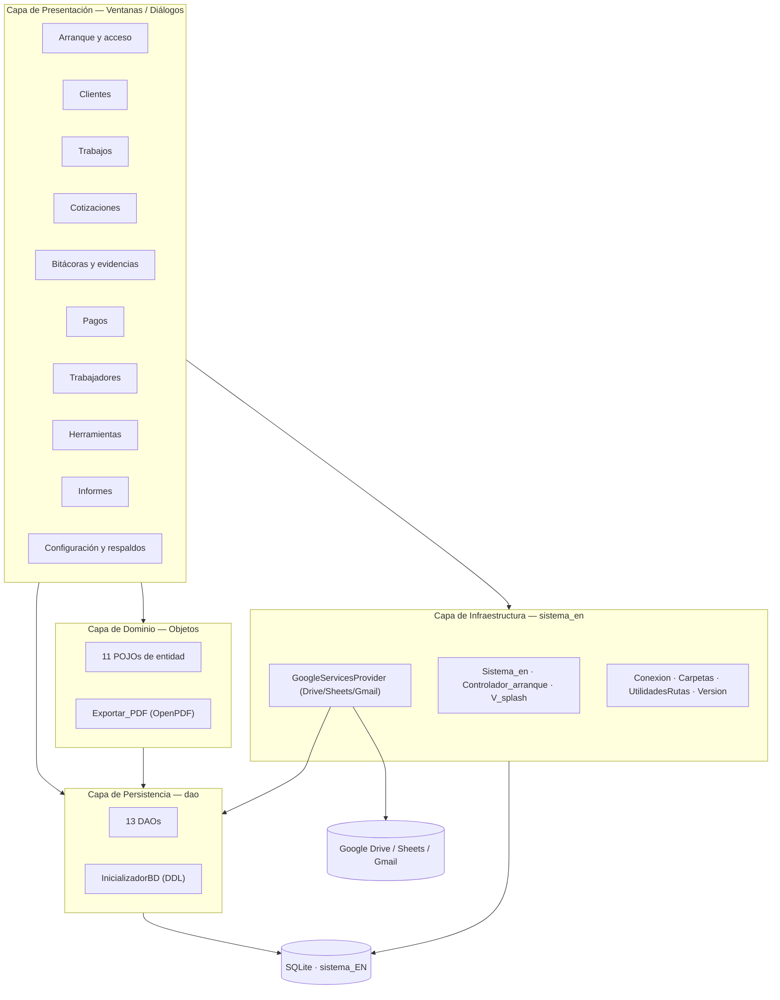
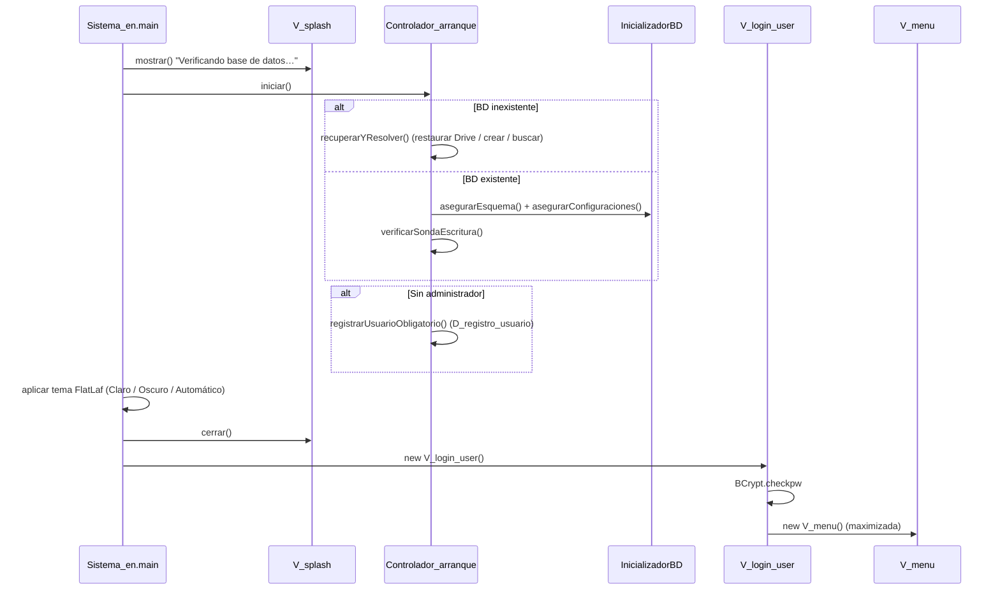
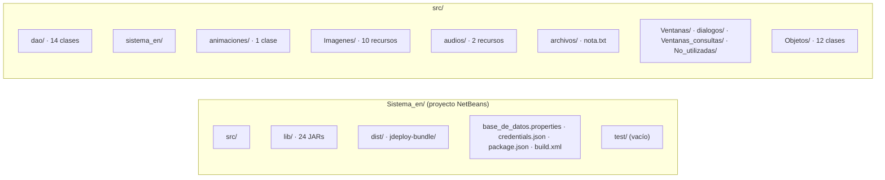
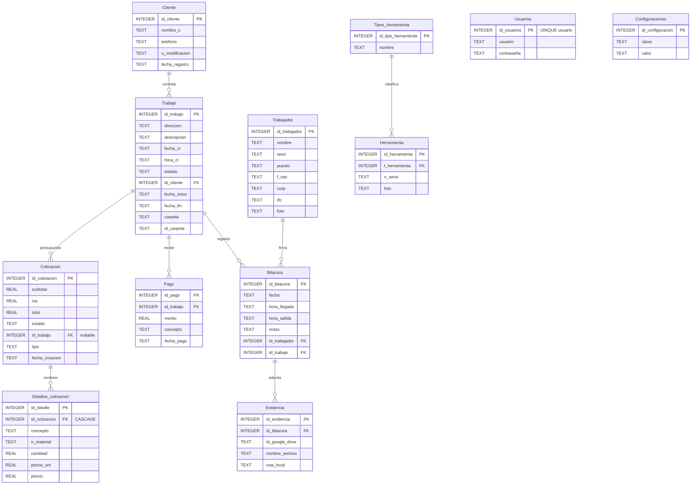

# Módulos — Sistema EN

> **Proyecto:** Sistema EN — Sistema de gestión para *ESTIBEN NAVARRO SOLUCIONES HIDRO-SANITARIAS*
> **Versión:** 1.1.0 · **Lenguaje:** Java 17 · **IDE:** NetBeans 17 · **UI:** Swing (GUI Builder)
> **Fuente del análisis:** 70 archivos `.java` + 33 `.form` en `Sistema_en/src/` (27 031 líneas de Java)
> **Alcance:** inventario completo de los módulos que componen el sistema, con sus clases, dependencias y responsabilidades.

---

## Índice

1. [Resumen de la arquitectura](#1-resumen-de-la-arquitectura)
2. [Módulos funcionales](#2-módulos-funcionales)
3. [Módulos técnicos (por capa)](#3-módulos-técnicos-por-capa)
4. [Paquetes y rutas del proyecto](#4-paquetes-y-rutas-del-proyecto)
5. [Modelo de datos](#5-modelo-de-datos)
6. [Inventario de pantallas](#6-inventario-de-pantallas)
7. [Integraciones externas](#7-integraciones-externas)
8. [Dependencias y librerías](#8-dependencias-y-librerías)
9. [Métricas y mapa de calor](#9-métricas-y-mapa-de-calor)
10. [Hallazgos y funcionalidad incompleta](#10-hallazgos-y-funcionalidad-incompleta)

---

## 1. Resumen de la arquitectura

Sistema de escritorio con arquitectura **en capas** (sin framework de inyección de dependencias):



**Flujo de arranque:**



**Resumen de módulos por área:**

| # | Módulo funcional | Clases Java | LOC aprox. |
|---|---|---|---:|
| 1 | Arranque, recuperación y versión | 4 | 577 |
| 2 | Usuarios y acceso | 5 | 1 461 |
| 3 | Clientes | 4 | 1 855 |
| 4 | Trabajos (órdenes de servicio) | 7 | 3 888 |
| 5 | Cotizaciones y exportación | 4 | 3 000 |
| 6 | Bitácoras y evidencias | 4 | 2 390 |
| 7 | Pagos | 2 | 944 |
| 8 | Trabajadores (personal) | 3 | 2 172 |
| 9 | Inventario de herramientas | 4 | 1 410 |
| 10 | Informes y estadísticas | 4 | 994 |
| 11 | Configuración y respaldos | 6 | 1 549 |
| 12 | Integración Google Cloud | 1 | 1 091 |
| 13 | Soporte, licencias y acerca de | 5 | 1 214 |
| — | Servicios transversales (PDF, spinner, rutas) | 4 | 501 |

---

## 2. Módulos funcionales

### 2.1 Módulo de Arranque, Recuperación y Versión

Punto de entrada de la aplicación y asistente de arranque. Se ejecuta **antes** del login y resuelve cualquier problema de la base de datos local.

| Clase | Ubicación | LOC | Responsabilidad |
|---|---|---:|---|
| `Sistema_en` | `sistema_en/` | 132 | Clase `main`. Muestra el splash, invoca `Controlador_arranque.iniciar()`, aplica el tema (FlatLaf claro/oscuro/automático) y abre el login. |
| `Controlador_arranque` | `sistema_en/` | 319 | Orquestador de arranque. Detecta BD ausente/bloqueada/solo-lectura y ofrece recuperación. |
| `V_splash` | `sistema_en/` | 93 | `JWindow` de carga con duración mínima garantizada (1200 ms) y etiqueta de estado. |
| `Version` | `sistema_en/` | 33 | Expone la versión del programa y lee notas de versión empaquetadas como recursos. |

**Capacidades:**
- `Controlador_arranque.iniciar()` — valida existencia y writability de la BD; ejecuta `asegurarEsquema()` y `asegurarConfiguraciones()`; corre una **sonda de escritura** con la tabla temporal `_sonda_escritura`.
- Recuperación: *restaurar desde Google Drive*, *vincular cuenta de Google*, *crear BD en ubicación por defecto*, *buscar BD manualmente*.
- Diagnóstico de BD bloqueada: 3 causas documentadas (otra instancia de la app, antivirus/backup de Windows, visor de BD abierto).
- Registro obligatorio del primer usuario si la tabla `Usuarios` está vacía.

---

### 2.2 Módulo de Usuarios y Acceso

Autenticación, registro de usuarios y cambio de credenciales. Usa **BCrypt** para el hash de contraseñas.

| Clase | Ubicación | LOC | Responsabilidad |
|---|---|---:|---|
| `V_login_user` | `Ventanas/` | 479 | Ventana de acceso. Valida con `BCrypt.checkpw`, navegación por teclado, avisos de error. |
| `D_registro_usuario` | `Ventanas/dialogos/` | 160 | Alta del primer usuario (usuario + contraseña + confirmación, mínimo 4 caracteres). |
| `D_cambiar_contraseña` | `Ventanas/dialogos/` | 619 | Dos pestañas: cambiar contraseña (verifica hash actual) y cambiar nombre de usuario. |
| `UsuariosDAO` | `dao/` | 113 | CRUD de usuarios con hash BCrypt. |
| `Cliente` (parcial) | — | — | *(el campo `u_modificacion` de `Cliente` traza el usuario que editó el registro)* |

**API de `UsuariosDAO`:**

| Método | Operación |
|---|---|
| `insertarUsuario(usuario, contraseña)` | C — aplica `BCrypt.hashpw(pwd, gensalt())` antes de insertar |
| `obtenerHashPorId(id)` | R — hash almacenado (validación del cambio de contraseña) |
| `actualizarContraseña(id, contraseña)` | U — re-hashea automáticamente |
| `actualizarUsuario(id, usuario)` | U — nombre de usuario |
| `existeAdministrador()` | R — `COUNT(*)`; fuerza el registro del primer usuario |

> **Nota:** la verificación de contraseña (`BCrypt.checkpw`) vive en la capa de vistas (`V_login_user`, `D_cambiar_contraseña`), no en el DAO.
> **Riesgo:** `D_cambiar_contraseña` opera siempre sobre el usuario `id = 1` (hardcodeado).

---

### 2.3 Módulo de Clientes

Catálogo de clientes con búsqueda, ordenamiento, ficha detallada y association con sus trabajos.

| Clase | Ubicación | LOC | Responsabilidad |
|---|---|---:|---|
| `V_clientes` | `Ventanas/Ventanas_consultas/` | 711 | Listado con ordenamiento (nombre A-Z/Z-A, número de trabajos asc/desc), split pane y escalado de tipografías. |
| `D_buscar_cliente` | `Ventanas/dialogos/` | 422 | Buscador por nombre y teléfono. Devuelve el `id` de la fila seleccionada. |
| `D_ficha_cliente` | `Ventanas/dialogos/` | 681 | Ficha con pestañas *Ficha* y *Trabajos*; edición in-place, resumen y navegación a la ficha del trabajo. |
| `ClienteDAO` | `dao/` | 427 | CRUD + *get-or-create* por identidad natural. |
| `Cliente` | `Objetos/` | 93 | POJO: `id_cliente`, `nombre_c`, `telefono`, `u_modificacion`, `fecha_registro`. |

**Capacidades:**
- `ClienteDAO.obtenerOCrearCliente(nombre, telefono, fecha_registro)` — busca por terna; si no existe inserta y devuelve el id generado. Usado por `V_R_Trabajo` para clientes nuevos en línea.
- Ordenamientos múltiples: `obtenerClientes()`, `obtenerClientesNumerosTrabajo{Asc,Desc,Alf,Fla}()` con `LEFT JOIN Trabajo` y `COUNT`.
- `filtrarClientesNombre(nombre)` — búsqueda con `LIKE '%?%'`.
- La ficha muestra *Número de trabajos* y *Fecha del último trabajo completado* (vía `TrabajoDAO.obtener_fecha_ultimo_trabajo_estado("Completado")`).

> **Nota:** no existe `eliminarCliente()` en la capa DAO.

---

### 2.4 Módulo de Trabajos (Órdenes de Servicio)

Entidad central del sistema. De ella cuelgan cotizaciones, pagos y bitácoras. Incluye sincronización con carpetas de Google Drive.

| Clase | Ubicación | LOC | Responsabilidad |
|---|---|---:|---|
| `V_R_Trabajo` | `Ventanas/` | 1 187 | Alta, edición, eliminación y listado de trabajos. Fecha/hora autogeneradas, estado inicial `Pendiente`. |
| `V_trabajos` | `Ventanas/Ventanas_consultas/` | 434 | Historial de trabajos con filtro por estado (Todos/Pendiente/En progreso/Completado). |
| `D_buscar_trabajo` | `Ventanas/dialogos/` | 317 | Buscador por fecha de registro y estado. |
| `D_ficha_trabajo` | `Ventanas/dialogos/` | 642 | Ficha del trabajo; abre los módulos asociados (Cotización, Bitácora, Pagos, Información estática). |
| `D_informacion_estatica` | `Ventanas/dialogos/` | 476 | Datos derivados del trabajo: cliente, nº de bitácoras, nº de pagos, fechas oficiales inicio/fin. |
| `TrabajoDAO` | `dao/` | 520 | CRUD + filtros por estado + sincronización de carpeta. |
| `Trabajo` | `Objetos/` | 201 | POJO: id, descripción, dirección, `fecha_cr`/`hora_cr`, `estado`, `id_cliente`, `fecha_inicio`/`fecha_fin`, `carpeta`, `id_carpeta`. |

**Estados:** `Pendiente` · `En progreso` · `Completado` (definidos en `JComboBox` de la UI y replicados en literales SQL).

**Sincronización con Drive:** al crear un trabajo se genera la carpeta `Trabajo_<id>_<idCliente>_<fecha>` en Google Drive; el `id_carpeta` se persiste en la BD. `GoogleServicesProvider.sincronizarTrabajosPendientes()` crea las carpetas de los trabajos con `carpeta = 'Pendiente'`.

**Filtros de `TrabajoDAO`:** `obtenerTrabajosConClientesCompletado()`, `...Progreso()`, `...Pendiente()`.

---

### 2.5 Módulo de Cotizaciones y Exportación

Emisión de cotizaciones con cálculo de IVA, exportación a PDF y a Google Sheets. Es el módulo más complejo (2 214 + 498 + 129 + 223 = ~3 000 LOC).

| Clase | Ubicación | LOC | Responsabilidad |
|---|---|---:|---|
| `V_R_Cotizacion` | `Ventanas/` | 2 214 | Editor de cotizaciones: listas de conceptos y materiales, cálculos, guardado transaccional, exportación. |
| `CotizacionDAO` | `dao/` | 498 | Cabecera de cotizaciones con transacciones ACID y reintentos ante bloqueo de SQLite. |
| `Detalles_cotizacionDAO` | `dao/` | 129 | CRUD de las partidas (concepto / material) de una cotización. |
| `Exportar_PDF` | `Objetos/` | 223 | Generación de PDF con OpenPDF (cotizaciones e informes). |
| `Cotizacion` | `Objetos/` | 207 | POJO: subtotal, iva, total, estado, `id_trabajo`, tipo, `fecha_creacion`. |
| `Detalles_cotizacion` | `Objetos/` | 125 | POJO de partida; polimórfico: concepto **o** material según el campo poblado. |
| `V_historial_c` | `Ventanas/Ventanas_consultas/` | 296 | Historial de cotizaciones y archivadas. *(ver §10 — no operativa)* |

**Cálculo de totales** (en `V_R_Cotizacion.calcular_total()`):
```
subtotal = Σ(Tabla_conceptos.precio) + Σ(Tabla_materiales.precio_total)
iva      = subtotal × 0.16
total    = subtotal + iva
```

**Estados de cotización:** `Borrador` · `Pendiente` · `Enviada` · `Aprobada` · `Rechazada` · `Cancelada`. Solo una cotización `Aprobada` por trabajo.

**Tipos:** `Normal` (asociada a un trabajo) · `Prueba` (sin trabajo asociado, `id_trabajo` admite `NULL`).

**Exportaciones:**
- **PDF** → `Exportar_PDF.exportarCotizacionPDF()` (OpenPDF): logo, folio, cliente, estado, tabla de conceptos, tabla de materiales y totales. Ejecución en `SwingWorker`.
- **Google Sheets** → `GoogleServicesProvider.crearHojaCotizacion()`: crea la hoja, la formatea (`BatchUpdateSpreadsheetRequest`, moneda `$#,##0.00`) y la mueve a `Cotizaciones/Excel/` del trabajo.

> **Riesgo:** el botón *"Convertir a trabajo"* (`b_convertir`) no tiene listener implementado.
> **Riesgo:** el IVA `0.16f` está hardcodeado en la vista; no es configurable.

---

### 2.6 Módulo de Bitácoras y Evidencias

Registro de jornadas de los trabajadores con evidencias fotográficas almacenadas en Google Drive y/o en disco local.

| Clase | Ubicación | LOC | Responsabilidad |
|---|---|---:|---|
| `V_R_Bitacora` | `Ventanas/` | 1 794 | Registro de bitácoras: navegación por `JTree` agrupado por fecha, gestión de evidencias. |
| `D_buscar_bitacora` | `Ventanas/dialogos/` | 290 | Búsqueda por fecha dentro de un trabajo. |
| `BitacoraDAO` | `dao/` | 150 | CRUD de bitácoras con carga en cascada de evidencias. |
| `EvidenciaDAO` | `dao/` | 147 | CRUD de evidencias (almacenamiento dual: Drive + local). |
| `Bitacora` | `Objetos/` | 140 | POJO: fecha, hora llegada/salida, notas, `id_trabajador`, `id_trabajo`, `evidencias`. |
| `Evidencia` | `Objetos/` | 93 | POJO: `id_bitacora`, `id_google_drive`, `nombre_archivo`, `ruta_local`. |
| `LoadingSpinner` | `animaciones/` | 156 | Spinner de carga dibujado con `Graphics2D` (usado por `V_R_Cotizacion`). |

**Capacidades:**
- Navegación por `JTree`: raíz → todos, nodo fecha → filtrado, hoja → formulario.
- Dos orígenes de evidencia: *seleccionar de Drive* (lista la carpeta `Evidencias` en un hilo aparte, solo archivos de imagen) y *subir imagen local* (`JFileChooser` → `subirImagenACarpeta`).
- **Estrategia cache-first**: `verificarYDescargarEvidencia(idDrive, ruta)` no descarga si la imagen ya existe en disco → permite trabajo offline.
- `BitacoraDAO` compone `EvidenciaDAO` para la carga en cascada (campo inyectado).

> **Riesgo:** carga en cascada de evidencias con patrón **N+1** (una consulta por bitácora).

---

### 2.7 Módulo de Pagos

Registro de abonos y pagos contra un trabajo, con cálculo de saldo pendiente.

| Clase | Ubicación | LOC | Responsabilidad |
|---|---|---:|---|
| `D_registrar_pagos` | `Ventanas/dialogos/` | 797 | Total presupuestado, total abonado, saldo pendiente, tabla de pagos, alta/edición. |
| `PagoDAO` | `dao/` | 147 | CRUD de pagos + agregados (`sumarPagosPorTrabajo`, `contarPagosPorTrabajo`). |
| `Pago` | `Objetos/` | 94 | POJO: `id_pago`, `id_trabajo`, `monto`, `concepto`, `fecha_pago`. |

**Lógica de saldo** (en `D_registrar_pagos.cargarTrabajo()`):
```
presupuestado = CotizacionDAO.obtenerTotal(id_trabajo)   // solo cotizaciones Aprobadas
abonado       = PagoDAO.sumarPagosPorTrabajo(id_trabajo)  // SUM(monto)
saldo         = max(0, presupuestado - abonado)
```
El único punto del proyecto con formato de moneda es `String.format("$%,.2f", valor)`.

**Validaciones:** campos obligatorios, monto numérico, concepto no numérico, fecha no futura.

> **Riesgo:** `PagoDAO.sumarPagosPorTrabajo()` devuelve `int`, truncando los centavos de importes `float`.

---

### 2.8 Módulo de Trabajadores (Personal)

CRUD de empleados/técnicos con datos oficiales mexicanos (CURP, RFC) y control de edad.

| Clase | Ubicación | LOC | Responsabilidad |
|---|---|---:|---|
| `V_R_Empleado` | `Ventanas/` | 1 447 | Alta/edición/borrado de trabajadores: puesto, RFC, CURP, fecha de nacimiento, foto. |
| `D_buscar_empleado` | `Ventanas/dialogos/` | 513 | Buscador por nombre y puesto (con filtrado en vivo por `KeyListener`). |
| `TrabajadorDAO` | `dao/` | 201 | CRUD de trabajadores + búsqueda por puesto. |
| `Trabajador` | `Objetos/` | 137 | POJO: nombre, sexo, puesto, RFC, CURP, `f_nac`, foto. |

**Puestos:** `Ayudante` · `Oficial` · `Medio oficial` · `Cabo`.

**Regla de negocio:** `verificar_edad()` exige **≥ 18 años**.

**Integración UI:** *LGoodDatePicker* (`DatePicker`) para fecha de nacimiento; `FlatLaf.isLafDark()` para icono de foto claro/oscuro.

---

### 2.9 Módulo de Inventario de Herramientas

CRUD del inventario de herramientas y su catálogo de tipos.

| Clase | Ubicación | LOC | Responsabilidad |
|---|---|---:|---|
| `V_R_Herramienta` | `Ventanas/` | 976 | Alta/edición/borrado de herramientas: tipo, número de serie, foto. Tipos editables en línea. |
| `D_buscar_herramienta` | `Ventanas/dialogos/` | 301 | Búsqueda por número de serie y tipo. |
| `HerramientaDAO` | `dao/` | 168 | CRUD con `LEFT JOIN` a `Tipos_herramienta`. |
| `Tipos_herramientaDAO` | `dao/` | 100 | Catálogo de tipos: inserción y lectura (sin update/delete). |
| `Herramienta` | `Objetos/` | 80 | POJO: `id_herramienta`, `t_herramienta` (FK), `n_serie`, `foto`. |
| `Tipos_herramienta` | `Objetos/` | 49 | POJO del catálogo. |

**Característica:** el inventario está **desconectado** del flujo operativo (trabajos, cotizaciones, pagos, bitácoras no lo referencian en el modelo).

---

### 2.10 Módulo de Informes y Estadísticas

Informe mensual comparativo con exportación a PDF y contraste entre periodos.

| Clase | Ubicación | LOC | Responsabilidad |
|---|---|---:|---|
| `D_informes` | `Ventanas/dialogos/` | 612 | Informe del mes con 4 pestañas (Trabajos, Clientes, Cotizaciones, Otros); revisión/exportación por periodo. |
| `D_contrastar_datos` | `Ventanas/dialogos/` | 261 | Selección de dos periodos y tipo de contraste (Numérico, Textual, Mixta). |
| `D_resultados_contraste` | `Ventanas/dialogos/` | 121 | Tabla de diferencias + resumen textual entre dos periodos. |
| `InformesDAO` | `dao/` | 163 | DAO de solo lectura/analítica (10 métricas + periodos disponibles). |
| `Exportar_PDF` | `Objetos/` | (compartido) | `exportarInformePDF()` — 4 tablas de 2 columnas. |

**Métricas de `InformesDAO`:**

| Métrica | Origen |
|---|---|
| Trabajos registrados / iniciados / finalizados | `Trabajo.fecha_cr` / `fecha_inicio` / `fecha_fin` |
| Clientes nuevos | `Cliente.fecha_registro` |
| Cliente con más trabajos | `LEFT JOIN` + `ORDER BY total DESC LIMIT 1` |
| Clientes con un solo trabajo | Subconsulta `GROUP BY … HAVING COUNT = 1` |
| Cotizaciones registradas / convertidas | `Cotizacion.fecha_creacion` / `id_trabajo IS NOT NULL` |
| Promedio de trabajos por cliente | `COUNT(trabajos) / COUNT(DISTINCT clientes)` |
| Promedio de duración de trabajo | `AVG(JULIANDAY(fin) - JULIANDAY(inicio))` — función nativa de SQLite |
| Periodos disponibles | `strftime('%Y-%m', …)` sobre `UNION` de 3 fechas |

> **Nota:** usa funciones propias de SQLite (`strftime`, `JULIANDAY`).

---

### 2.11 Módulo de Configuración y Respaldos

Configuración de la aplicación (tema, sonido, carpetas, copias de seguridad) y gestión de respaldos en Google Drive.

| Clase | Ubicación | LOC | Responsabilidad |
|---|---|---:|---|
| `D_configuraciones` | `Ventanas/dialogos/` | 646 | Preferencias: tema, sonido, carpeta de cotizaciones, apertura automática, cambio de contraseña. |
| `D_copias_seguridad` | `Ventanas/dialogos/` | 662 | Estado de Google Drive, vincular/desconectar, frecuencia de copia, ubicación de la BD, subida manual. |
| `ConfiguracionesDAO` | `dao/` | 166 | Persistencia clave/valor (batch transaccional). |
| `Configuraciones` | `Objetos/` | 61 | POJO: `id_configuracion`, `clave`, `valor`. |
| `Conexion` | `sistema_en/` | 127 | Fachada de BD: resuelve la ruta del SQLite, la persiste en `base_de_datos.properties` y fabrica `Connection`. |
| `Carpetas` | `sistema_en/` | 109 | Utilidades de sistema de archivos: crear, verificar y **mover** carpetas de cotizaciones/evidencias. |
| `UtilidadesRutas` | `sistema_en/` | 71 | Resuelve rutas: JAR, config de usuario (`~/.Sistema_EN`), tokens y `credentials.json`. |

**Claves de configuración por defecto** (sembradas por `InicializadorBD.asegurarConfiguraciones()`):

| Clave | Valor por defecto | Función |
|---|---|---|
| `tema` | `Claro` | Tema de la UI (Claro / Oscuro / Automático) |
| `sonido_error` | `false` | Reproducir `/audios/error.wav` en errores |
| `frecuencia` | `diaria` | Frecuencia de copia de seguridad (diaria / semanal / cada cierre / manual) |
| `preguntar` | `true` | Preguntar antes de la copia al cerrar |
| `manual` | `false` | Solo copia manual |
| `cotizaciones` | `true` | Subir PDFs de cotizaciones a Drive |
| `ultima_copia` | `""` | Fecha de la última copia (control de frecuencia) |
| `automaticamente_ce` | `true` | Abrir automáticamente el PDF exportado |
| `automaticamente_ce_excel` | `true` | Abrir automáticamente la hoja de cálculo |
| `carpeta_ce` | `<Documentos>` | Carpeta de cotizaciones exportadas |
| `base_c` | `<dir BD>` | Carpeta base de la BD |

**Respaldo automático** (en `V_menu`): al abrir el menú se compara `ChronoUnit.DAYS.between(fechaGuardada, hoy) >= dias` (1 o 7 según frecuencia) y se lanza la copia en `SwingUtilities.invokeLater`.

**Rutas de datos:**

| Dato | Ubicación |
|---|---|
| BD por defecto | `Documentos/Documents/Bases de datos/sistema_EN` |
| Config de la ruta BD | `~/.Sistema_EN/base_de_datos.properties` (Linux) · `%APPDATA%\.Sistema_EN` (Windows) |
| Tokens de Google | `~/.Sistema_EN/tokens` (permisos `700`) |
| Credenciales OAuth | `credentials.json` (incluido en el instalador) |

> **Riesgo (bug factual):** `ConfiguracionesDAO.actualizarConfiguraciones()` escribe el valor de `automaticamente_ce_excel` bajo la clave `"automaticamente_ce"`, sobrescribiendo la anterior; la clave `automaticamente_ce_excel` nunca se actualiza desde ese método.

---

### 2.12 Módulo de Integración Google Cloud

Fachada monolítica (1 091 LOC) para Google Drive, Google Sheets y Gmail. Es el módulo de integración más pesado.

| Clase | Ubicación | LOC | Responsabilidad |
|---|---|---:|---|
| `GoogleServicesProvider` | `sistema_en/` | 1 091 | OAuth2 + Drive (respaldo, carpetas de trabajo, evidencias) + Sheets (cotizaciones) + Gmail (soporte). |

**Servicios y scopes:**

| Servicio | API | Scope | Uso |
|---|---|---|---|
| Google Drive | `drive-v3-rev20230822` | `DriveScopes.DRIVE` (acceso total) | Respaldo/restore de la BD, carpetas de trabajos, evidencias, PDFs |
| Google Sheets | `sheets-v4-rev20220927` | `SheetsScopes.SPREADSHEETS` | Cotizaciones formateadas |
| Gmail | `gmail-v1-rev20260727` | `GmailScopes.GMAIL_SEND` (solo envío) | Tickets de soporte técnico con adjuntos |

**Autenticación (`getCredentials()`, `synchronized`):**
1. Busca `credentials.json` en 3 candidatos (junto al JAR → carpeta de usuario → `user.dir`).
2. Construye `GoogleAuthorizationCodeFlow` con `FileDataStoreFactory` (tokens en disco) y `setAccessType("offline")` (refresh token).
3. `LocalServerReceiver` en **puerto fijo 9999** + `AuthorizationCodeInstalledApp`.
4. Manejo de `invalid_grant` → `desconectar()` y re-autenticación transparente con reintento de la petición.

**API pública por servicio:**

| Servicio | Operaciones principales |
|---|---|
| **Drive** | `crearCarpetaTrabajo()`, `buscarOCrearCarpeta()`, `subirImagenACarpeta()`, `subirArchivo()` (respaldo), `listarArchivosDeCarpeta()`, `descargarContenidoCarpeta()`, `descargarRespaldoBaseDatos()`, `verificarYDescargarEvidencia()`, `moverDesdeRaiz()`, `limpiarCarpetaTemporal()`, `obtenerIdCarpetaBaseDatos()` |
| **Sheets** | `crearHojaCotizacion()`, `aplicarFormatoCotizacion()` (~310 líneas de formato), `Obtener_url_google_sheets()` |
| **Gmail** | `enviarCorreo(destinatario, asunto, cuerpo, tipo, prioridad, adjuntos)` — MIME `multipart/mixed` manual, adjuntos separados por `;` |
| **Sincronización** | `sincronizarTrabajosPendientes()` y `subirCotizacionesPdf(ruta)` — ambos en `SwingWorker` |

> **Riesgo:** `estaConectado()` es una heurística basada en el sistema de archivos (la carpeta `tokens` existe y no está vacía); no valida el token contra la API.
> **Riesgo:** `subirCotizacionesPdf()` concatena la ruta con `ruta + f.getName()` sin separador (línea 819).

---

### 2.13 Módulo de Soporte, Licencias y Acerca de

Diálogos informativos y de comunicación con el proveedor del software.

| Clase | Ubicación | LOC | Responsabilidad |
|---|---|---:|---|
| `D_soporte_tecnico` | `Ventanas/dialogos/` | 313 | Solicitud de soporte (Error/Mantenimiento/Mejora, prioridad Alta/Media/Baja, adjuntos múltiples) enviada por **Gmail API**. |
| `D_licencias_terceros_tabla` | `Ventanas/dialogos/` | 312 | Tabla con **36 librerías** de terceros (nombre, versión, licencia). |
| `D_licencias_terceros` | `Ventanas/dialogos/` | 134 | Texto legal completo (MIT, LGPL 2.1, ISC, BSD). |
| `D_acerca_de` | `Ventanas/dialogos/` | 455 | Logo, versión, © 2026 Softium S.A., enlaces a licencias, soporte, nota de versión y descargas. |
| `D_nota_version` | `Ventanas/dialogos/` | 192 | Notas de versión (leídas de `/archivos/nota.txt`) y registro de solicitudes de soporte. |
| `D_exportar_opciones` | `Ventanas/dialogos/` | 142 | Diálogo *huérfano* (PDF/EXCEL/Cancelar) — no referenciado desde ninguna clase. |
| `V_pago_recibido` | `Ventanas/No_utilizadas/` | 259 | Formulario anterior de pago recibido — **código muerto**. |
| `V_ficha_trabajo` | `Ventanas/No_utilizadas/` | 448 | Antecesor de `D_ficha_trabajo` — **código muerto**. |

**Envío de soporte:** `GoogleServicesProvider.enviarCorreo("aresbrandon@proton.me", …)` con adjuntos en base64.

> **Riesgo:** las descargas de manual/documentación en `D_acerca_de` apuntan a `https://ejemplo.com/documento.pdf` (URL placeholder).

---

## 3. Módulos técnicos (por capa)

### 3.1 Capa de Presentación — `sistema_en.Ventanas`

| Sub-paquete | Archivos `.java` | LOC | Contenido |
|---|---:|---:|---|
| (raíz) | 7 | 8 892 | `V_login_user`, `V_menu`, `V_R_Trabajo`, `V_R_Cotizacion`, `V_R_Empleado`, `V_R_Herramienta`, `V_R_Bitacora` |
| `Ventanas_consultas/` | 3 | 1 441 | `V_clientes`, `V_trabajos`, `V_historial_c` |
| `dialogos/` | 23 | 7 273 | 23 diálogos `D_*` (fichas, búsquedas, pagos, configuración, informes, soporte, licencias, usuarios) |
| `No_utilizadas/` | 2 | 707 | `V_ficha_trabajo`, `V_pago_recibido` (código muerto) |
| **Total** | **35** | **18 313** | + 33 archivos `.form` (NetBeans GUI Builder) |

**Convenciones de nombres:**
- `V_` = ventana (JFrame), `D_` = diálogo (JDialog).
- `V_R_` = ventana de **registro** (CRUD); `V_` en `Ventanas_consultas` = ventana de solo lectura.
- Patrón singleton de navegación: `if (ventana == null || !ventana.isDisplayable())`.
- Todas las ventanas se abren con `MAXIMIZED_BOTH` + `toFront()` / `requestFocus()`.

**Tecnologías de UI usadas:**

| Tecnología | Uso |
|---|---|
| **FlatLaf 3.7.1** | Temas claro/oscuro; `FlatLightLaf.setup()` / `FlatDarkLaf.setup()`; `FlatLaf.isLafDark()` para iconos adaptativos |
| **jSystemThemeDetector 3.9** | Tema `Automático` vía `OsThemeDetector` (arrastrando JNA + OSHI) |
| **AbsoluteLayout** | Layout de los `.form` de `V_menu` y `V_login_user` |
| **LGoodDatePicker 11.2.1** | `DatePicker` (fechas) y `TimePicker` (horas) en 8 pantallas |
| **Swing Toast Notifications** | Notificaciones no bloqueantes de éxito/error (`raven.toast.Notifications`) |
| **SwingWorker** | Operaciones en segundo plano: export PDF/Sheets, carga de evidencias, informes |
| **javax.sound** | Reproducción de `/audios/error.wav` e `/audios/inicio.wav` |
| **JCalendar 1.4** | ⚠ Declarada en `lib/` pero **sin uso en el código** |
| **Cámara / webcam** | ⚠ No existe captura por webcam; el icono de cámara es decorativo |

---

### 3.2 Capa de Dominio — `sistema_en.Objetos`

**11 POJOs de entidad + 1 clase de servicio.**

| Clase | LOC | Campos principales | Relaciones (FK) |
|---|---:|---|---|
| `Cotizacion` | 207 | subtotal, iva, total, estado, tipo, `fecha_creacion` | → `Trabajo` |
| `Trabajo` | 201 | descripción, dirección, `fecha_cr`/`hora_cr`, estado, `fecha_inicio`/`fecha_fin`, `carpeta`, `id_carpeta` | → `Cliente` |
| `Bitacora` | 140 | fecha, `hora_llegada`/`hora_salida`, notas, **`evidencias: List<Evidencia>`** | → `Trabajador`, `Trabajo`, `Evidencia` |
| `Trabajador` | 137 | nombre, sexo, puesto, RFC, CURP, `f_nac`, foto | — |
| `Detalles_cotizacion` | 125 | concepto / `n_material`, cantidad, `precio_uni`, precio | → `Cotizacion` |
| `Pago` | 94 | monto, concepto, `fecha_pago` | → `Trabajo` |
| `Cliente` | 93 | `nombre_c`, telefono, `u_modificacion`, `fecha_registro` | — |
| `Evidencia` | 93 | `id_google_drive`, `nombre_archivo`, `ruta_local` | → `Bitacora` |
| `Herramienta` | 80 | `t_herramienta`, `n_serie`, foto | → `Tipos_herramienta` |
| `Configuraciones` | 61 | clave, valor | — |
| `Tipos_herramienta` | 49 | nombre | — |
| `Exportar_PDF` | 223 | *(servicio, sin estado)* | — |

**Características del modelo:**
- POJOs planos (JavaBeans): constructores vacíos, getters/setters.
- **Relaciones por clave primaria foránea (`int`)**, no por referencia a objeto. Única excepción: `Bitacora.evidencias: List<Evidencia>`.
- Sin `equals`/`hashCode`/`toString`.
- Importes monetarios en `float` (no `BigDecimal`).
- Estados como `String` libre, no `enum`; los valores viven en los `JComboBox` de la UI y en literales SQL.

---

### 3.3 Capa de Persistencia — `dao`

**13 DAOs + 1 inicializador.**

| DAO | LOC | Tablas | Operaciones | Librería externa |
|---|---:|---|---|---|
| `InicializadorBD` | 255 | *(12 CREATE TABLE)* | `asegurarEsquema()`, `asegurarConfiguraciones()`, `crearBaseDatos()` | — |
| `TrabajoDAO` | 520 | `Trabajo`, `Cliente` | C R U D + filtros por estado + sync de carpeta | `java.time` |
| `CotizacionDAO` | 498 | `Cotizacion`, `Detalles_cotizacion` | C R U D **transaccional** + reintentos (3x) ante `SQLITE_BUSY` | `java.time` |
| `ClienteDAO` | 427 | `Cliente`, `Trabajo` | C R U + **get-or-create** + 5 variantes de ordenamiento | — |
| `TrabajadorDAO` | 201 | `Trabajador` | C R U D + búsqueda por puesto (SQL dinámico) | — |
| `ConfiguracionesDAO` | 166 | `Configuraciones` | R U (batch transaccional, 6 claves) | — |
| `InformesDAO` | 163 | `Trabajo`, `Cliente`, `Cotizacion` | R (10 métricas analíticas, solo lectura) | `strftime`, `JULIANDAY` |
| `HerramientaDAO` | 168 | `Herramienta`, `Tipos_herramienta` | C R U D + `LEFT JOIN` | — |
| `BitacoraDAO` | 150 | `Bitacora`, `Evidencia` | C R U + conteo + cascada de evidencias | `java.time` |
| `PagoDAO` | 147 | `Pago` | C R U + `SUM(monto)` + `COUNT` | `java.time` |
| `EvidenciaDAO` | 147 | `Evidencia` | C R U D (almacenamiento dual) | — |
| `Detalles_cotizacionDAO` | 129 | `Detalles_cotizacion` | C R U D | — |
| `UsuariosDAO` | 113 | `Usuarios` | C R U + `existeAdministrador()` | **jBCrypt** |
| `Tipos_herramientaDAO` | 100 | `Tipos_herramienta` | C R + `existeTipo()` (case-insensitive) | — |
| **Total** | **2 664** | | | |

**Patrón DAO:** manual, sin framework. Cada DAO abre su propia `Connection` con `try-with-resources` sobre `Conexion.conectar()` (URL: `jdbc:sqlite:<ruta>?busy_timeout=5000`).

**Mapa DAO × Tabla:**

| DAO | Cliente | Trabajo | Trabajador | Cotización | Detalles | Pago | Bitácora | Evidencia | Herramienta | Tipos | Usuarios | Config. |
|---|:-:|:-:|:-:|:-:|:-:|:-:|:-:|:-:|:-:|:-:|:-:|:-:|
| `ClienteDAO` | C R U | R | | | | | | | | | | |
| `TrabajoDAO` | R | C R U D | | | | | | | | | | |
| `TrabajadorDAO` | | | C R U D | | | | | | | | | | |
| `CotizacionDAO` | | | | C R U D | C U | | | | | | | |
| `Detalles_cotizacionDAO` | | | | | C R U D | | | | | | | | |
| `PagoDAO` | | | | | | C R U | | | | | | | |
| `BitacoraDAO` | | | R | | | | C R U | R | | | | | |
| `EvidenciaDAO` | | | | | | | | C R U D | | | | | |
| `HerramientaDAO` | | | | | | | | | C R U D | R | | | |
| `Tipos_herramientaDAO` | | | | | | | | | | C R | | | |
| `UsuariosDAO` | | | | | | | | | | | C R U | | |
| `ConfiguracionesDAO` | | | | | | | | | | | | R U | |
| `InformesDAO` | R | R | | R | | | | | | | | |

> **Nota:** `Controlador_arranque` opera la tabla efímera `_sonda_escritura` (crea → borra → drop) para comprobar permisos de escritura.

---

### 3.4 Capa de Infraestructura — `sistema_en`

| Clase | LOC | Responsabilidad |
|---|---:|---|
| `Sistema_en` | 132 | `main`: splash → arranque → tema → login |
| `Conexion` | 127 | Fachada de BD: ruta configurable + fábrica de `Connection`; `VERSION_APP = "1.1.0"` |
| `Controlador_arranque` | 319 | Asistente de arranque y recuperación de BD |
| `GoogleServicesProvider` | 1 091 | Drive / Sheets / Gmail |
| `Carpetas` | 109 | Utilidades de sistema de archivos + clase interna `ObtenerImagenes` |
| `UtilidadesRutas` | 71 | Rutas del JAR, config de usuario, tokens, credenciales |
| `V_splash` | 93 | Pantalla de carga |
| `Version` | 33 | Versión + lectura de recursos de texto |
| **Total** | **1 975** | |

---

### 3.5 Servicios transversales

| Clase | Ubicación | LOC | Responsabilidad |
|---|---|---:|---|
| `Exportar_PDF` | `sistema_en/Objetos/` | 223 | `exportarCotizacionPDF()` y `exportarInformePDF()` con OpenPDF 1.3.39 (`com.lowagie.text`). |
| `LoadingSpinner` | `animaciones/` | 156 | Spinner dibujado con `Graphics2D`/`Arc2D`/`Path2D`; 3 estados: `LOADING`, `SUCCESS`, `ERROR`. |

---

## 4. Paquetes y rutas del proyecto



| Ruta | Contenido |
|---|---|
| `Sistema_en/src/dao/` | 14 clases — capa de persistencia |
| `Sistema_en/src/sistema_en/` | 8 clases — infraestructura, arranque y servicios |
| `Sistema_en/src/sistema_en/Objetos/` | 12 clases — dominio (11 POJOs + `Exportar_PDF`) |
| `Sistema_en/src/sistema_en/Ventanas/` | 7 clases `.java` + 7 `.form` — ventanas principales |
| `Sistema_en/src/sistema_en/Ventanas/dialogos/` | 23 clases `.java` + 21 `.form` — diálogos |
| `Sistema_en/src/sistema_en/Ventanas/Ventanas_consultas/` | 3 clases `.java` + 3 `.form` — ventanas de consulta |
| `Sistema_en/src/sistema_en/Ventanas/No_utilizadas/` | 2 clases `.java` + 2 `.form` — código muerto |
| `Sistema_en/src/animaciones/` | 1 clase — `LoadingSpinner` |
| `Sistema_en/src/Imagenes/` | 10 recursos (logos, iconos claro/oscuro) |
| `Sistema_en/src/audios/` | 2 recursos (`error.wav`, `inicio.wav`) |
| `Sistema_en/src/archivos/` | 1 recurso — `nota.txt` (notas de versión) |
| `Sistema_en/lib/` | 24 JARs + `librerias-google/` (17 JARs) |
| `Sistema_en/herramientas/` | `proguard.jar`, `proguard-ant.jar` (ofuscación) |
| `Sistema_en/test/` | Vacío — sin pruebas unitarias |
| `Sistema_en/credentials.json` | Credenciales OAuth de Google (tipo `installed`) |

---

## 5. Modelo de datos

**12 tablas** de dominio + 1 tabla efímera de sonda. Definidas en `dao/InicializadorBD.java`.



**Observaciones del esquema:**
- Todas las fechas/horas se almacenan como `TEXT` (no hay tipos temporales de SQLite) → conversiones a `LocalDate`/`LocalTime` en Java.
- **No hay `CREATE INDEX`**: los `JOIN`/`GROUP BY` operan sobre columnas sin índice.
- **No hay `PRAGMA foreign_keys = ON`**: las FKs están declaradas pero SQLite no las aplica por defecto → el `ON DELETE CASCADE` de `Detalles_cotizacion` puede no ejecutarse.
- `Evidencia.id_evidencia` es `PRIMARY KEY` **sin `AUTOINCREMENT`**.
- `Configuraciones.clave` **no tiene `UNIQUE`**: la deduplicación se hace en `asegurarConfiguraciones()` con `DELETE … GROUP BY clave`.

---

## 6. Inventario de pantallas

### 6.1 Ventanas principales (`V_`)

| Ventana | LOC | Propósito | Estado |
|---|---:|---|---|
| `V_splash` | 93 | Pantalla de carga con duración mínima | ✅ |
| `V_login_user` | 479 | Acceso al sistema (BCrypt) | ✅ |
| `V_menu` | 795 | Menú principal — lanzador de todos los módulos | ✅ |
| `V_R_Trabajo` | 1 187 | Registro/CRUD de trabajos | ✅ |
| `V_R_Cotizacion` | 2 214 | Cotizaciones, PDF y Excel | ⚠ botón *Convertir a trabajo* sin listener |
| `V_R_Empleado` | 1 447 | Registro/CRUD de trabajadores | ✅ |
| `V_R_Herramienta` | 976 | Registro/CRUD de herramientas | ✅ |
| `V_R_Bitacora` | 1 794 | Bitácoras y evidencias | ✅ |

### 6.2 Ventanas de consulta (`Ventanas_consultas/`)

| Ventana | LOC | Propósito | Estado |
|---|---:|---|---|
| `V_clientes` | 711 | Catálogo de clientes con ordenamientos | ✅ |
| `V_trabajos` | 434 | Historial de trabajos por estado | ✅ |
| `V_historial_c` | 296 | Historial de cotizaciones | ⚠ sin DAO, `b_buscar` sin handler, `b_restaurar` con `TODO` |

### 6.3 Diálogos (`dialogos/`)

| Grupo | Diálogos | Estado |
|---|---|---|
| **Fichas** | `D_ficha_cliente` (681), `D_ficha_trabajo` (642), `D_informacion_estatica` (476) | ✅ |
| **Búsquedas** | `D_buscar_cliente` (422) ⚠, `D_buscar_trabajo` (317) ⚠, `D_buscar_empleado` (513) ✅, `D_buscar_herramienta` (301) ⚠, `D_buscar_bitacora` (290) ✅ | Parcial |
| **Operación** | `D_registrar_pagos` (797) ✅ | ✅ |
| **Sistema** | `D_configuraciones` (646) ⚠, `D_copias_seguridad` (662) ⚠ | Parcial |
| **Informes** | `D_informes` (612) ✅, `D_contrastar_datos` (261) ✅, `D_resultados_contraste` (121) ✅ | ✅ |
| **Usuarios** | `D_registro_usuario` (160) ✅, `D_cambiar_contraseña` (619) ⚠ | Parcial |
| **Soporte/Legal** | `D_soporte_tecnico` (313) ✅, `D_licencias_terceros_tabla` (312) ✅, `D_licencias_terceros` (134) ✅, `D_acerca_de` (455) ⚠, `D_nota_version` (192) ⚠ | Parcial |
| **Huérfano** | `D_exportar_opciones` (142) — no referenciado | ❌ |

### 6.4 Navegación desde el menú principal

| Menú | Opción | Destino |
|---|---|---|
| `Registros ▼` | Empleado | `V_R_Empleado` |
| | Herramienta | `V_R_Herramienta` |
| | Trabajo | `V_R_Trabajo` |
| `Cotizaciones` | Cotización de prueba | `V_R_Cotizacion` (tipo `Prueba`) |
| `Catálogo ▼` | Ver clientes | `V_clientes` |
| | Ver trabajos | `V_trabajos` |
| | Historial | `V_historial_c` |
| `Sistema ▼` | Configuraciones | `D_configuraciones` |
| | Informes | `D_informes` |
| | Salir | Cierre + copia de seguridad |

---

## 7. Integraciones externas

| Servicio | API / Librería | Scopes / Permisos | Módulo consumidor |
|---|---|---|---|
| **Google Drive** | `google-api-services-drive-v3-rev20230822-2.0.0` | `DriveScopes.DRIVE` (acceso total) | Respaldos, carpetas de trabajo, evidencias, PDFs de cotización |
| **Google Sheets** | `google-api-services-sheets-v4-rev20220927-2.0.0` | `SheetsScopes.SPREADSHEETS` | Exportación de cotizaciones a Excel |
| **Gmail** | `google-api-services-gmail-v1-rev20260727-2.0.0` | `GmailScopes.GMAIL_SEND` (solo envío) | Solicitudes de soporte técnico |
| **OAuth2** | `google-oauth-client-java6/jetty-1.34.1` | *offline* (refresh token), `LocalServerReceiver` en puerto **9999** | Autenticación en `GoogleServicesProvider` |
| **Sistema de archivos local** | `java.nio.file`, `JFileChooser` | — | Rutas, fotos, evidencias, adjuntos, carpeta de la BD |

**Jerarquía de carpetas en Google Drive:**
```
(root)
├── Base de datos/          ← sistema_EN (respaldo SQLite)
└── Trabajos/
    └── Trabajo_<id>_<idCliente>_<fecha>/
        ├── Evidencias/     ← fotos de bitácoras
        └── Cotizaciones/
            ├── Excel/      ← Google Sheets
            └── PDF/        ← cotizaciones exportadas
```

---

## 8. Dependencias y librerías

### 8.1 `lib/` — 24 JARs de terceros

| Librería | Versión | Licencia | Uso en el proyecto |
|---|---|---|---|
| `sqlite-jdbc` | 3.53.2.0 | Apache 2.0 | **Todos** los DAO, `Conexion`, `InicializadorBD` |
| `jbcrypt` | 0.4 | MIT/ISC | `UsuariosDAO`, `V_login_user`, `D_cambiar_contraseña` |
| `flatlaf` | 3.7.1 | Apache 2.0 | Temas claro/oscuro |
| `flatlaf-extras` | 3.7.1 | Apache 2.0 | Extensiones FlatLaf |
| `jSystemThemeDetector` | 3.9 | MIT | Tema automático del SO |
| `LGoodDatePicker` | 11.2.1 | MIT | `DatePicker` y `TimePicker` |
| `openpdf` | 1.3.39 | LGPL/MPL | `Exportar_PDF` (com.lowagie.text) |
| `swing-toast-notifications` | 1.0.4 | MIT | Notificaciones de éxito/error |
| `jna` | 5.19.1 | Apache 2.0 / LGPL 2.1 | Transitivo (jSystemThemeDetector) |
| `jna-platform` | 5.19.1 | Apache 2.0 / LGPL 2.1 | Transitivo |
| `oshi-core` | 6.4.0 | MIT | Transitivo |
| `AbsoluteLayout` | — | CDDL/GPL | Layout de `.form` (NetBeans) |
| `org-netbeans-modules-java-j2seproject-copylibstask` | — | CDDL/GPL | Tarea de NetBeans para copiar librerías |
| `jsvg` | 2.1.0 | MIT | Renderizado SVG (transitivo de jgoodies) |
| `jgoodies-common` | 1.2.0 | BSD 3-Clause | Transitivo |
| `jgoodies-looks` | 2.4.1 | BSD 3-Clause | Transitivo |
| `jcalendar` | 1.4 | LGPL | ⚠ **Declarada pero sin uso** |
| `slf4j-api` | 2.0.13 | MIT | Logging (transitivo) |
| `slf4j-simple` | 2.0.18 | MIT | Backend de logging |
| `junit` | 4.6 | EPL 1.0 | Declarada; `test/` vacío |

### 8.2 `lib/librerias-google/` — 17 JARs

| Librería | Versión | Licencia |
|---|---|---|
| `google-api-services-drive-v3` | rev20230822-2.0.0 | Apache 2.0 |
| `google-api-services-sheets-v4` | rev20220927-2.0.0 | Apache 2.0 |
| `google-api-services-gmail-v1` | rev20260727-2.0.0 | Apache 2.0 |
| `google-api-client` | 2.2.0 | Apache 2.0 |
| `google-oauth-client-java6` | 1.34.1 | BSD 3-Clause |
| `google-oauth-client-jetty` | 1.34.1 | BSD 3-Clause |
| `google-http-client` | 1.43.3 | Apache 2.0 |
| `google-http-client-gson` | 1.42.3 | Apache 2.0 |
| `google-http-client-jackson2` | 1.43.3 | Apache 2.0 |
| `gson` | 2.10.1 | Apache 2.0 |
| `guava` | 32.1.2-jre | Apache 2.0 |
| `jackson-core` | 2.15.2 | Apache 2.0 |
| `grpc-context` | 1.53.0 | Apache 2.0 |
| `opencensus-api` | 0.28.0 | Apache 2.0 |
| `opencensus-contrib-http-util` | 0.28.0 | Apache 2.0 |

> **Total: 41 JARs de terceros**, con 36 declaradas en `D_licencias_terceros_tabla`.

---

## 9. Métricas y mapa de calor

| Métrica | Valor |
|---|---|
| Archivos `.java` | 70 |
| Archivos `.form` (NetBeans GUI Builder) | 33 |
| Líneas de Java | 27 031 |
| Clases de dominio (POJOs) | 12 (11 efectivas + 1 vacía) |
| Clases DAO | 13 (+ `InicializadorBD`) |
| Ventanas (`V_`) | 8 principales + 3 de consulta + 2 sin usar = 13 |
| Diálogos (`D_`) | 23 |
| Tablas de BD | 12 (+ 1 efímera) |
| Librerías de terceros | 41 JARs |
| Servicios Google | 3 (Drive, Sheets, Gmail) |
| Pruebas unitarias | 0 (`test/` vacío) |
| Versión | 1.1.0 |

**Top 10 de clases más grandes:**

| # | Clase | LOC | Módulo |
|---|---|---:|---|
| 1 | `V_R_Cotizacion.java` | 2 214 | Cotizaciones |
| 2 | `V_R_Bitacora.java` | 1 794 | Bitácoras |
| 3 | `V_R_Empleado.java` | 1 447 | Trabajadores |
| 4 | `V_R_Trabajo.java` | 1 187 | Trabajos |
| 5 | `GoogleServicesProvider.java` | 1 091 | Integración Google |
| 6 | `V_R_Herramienta.java` | 976 | Herramientas |
| 7 | `D_registrar_pagos.java` | 797 | Pagos |
| 8 | `V_menu.java` | 795 | Arranque / Navegación |
| 9 | `V_clientes.java` | 711 | Clientes |
| 10 | `D_ficha_cliente.java` | 681 | Clientes |

**Concentración:** los 3 archivos más grandes (5 455 LOC) representan el **20 %** del código y pertenecen a 2 módulos (Cotizaciones y Bitácoras).

---

## 10. Hallazgos y funcionalidad incompleta

### 10.1 Funcionalidad no operativa

| # | Ubicación | Hallazgo |
|---|---|---|
| 1 | `V_R_Cotizacion` | El botón **"Convertir a trabajo"** (`b_convertir`) se crea y se habilita/deshabilita, pero **no tiene `addActionListener`**. La conversión cotización → trabajo no está implementada. |
| 2 | `V_historial_c` | Ventana **sin ningún DAO**. `b_buscar` sin handler; `b_restaurar` solo contiene `// TODO`; `b_limpiar` únicamente limpia los selectores de fecha. |
| 3 | `D_buscar_cliente` | `b_buscar` **sin handler** — solo carga la tabla completa al abrir. |
| 4 | `D_buscar_trabajo` | `b_buscar` **sin handler**; el combo de estado muestra los valores por defecto `Item 1..4`. |
| 5 | `D_buscar_herramienta` | `b_buscar` con cuerpo vacío. |
| 6 | `D_acerca_de` | Las descargas de manual y documentación técnica apuntan a `https://ejemplo.com/documento.pdf` (**URL placeholder**). |
| 7 | `D_copias_seguridad` | El botón *"Importar de copia de seguridad"* solo verifica la conexión; **no restaura nada** (aunque `GoogleServicesProvider.descargarRespaldoBaseDatos()` existe y funciona). |
| 8 | `D_configuraciones` | La sección *"Configuración de Calendar"* (`ch_automaticamente_eventos`, `ch_recordatorio_informe`, `tp_hora_defecto`) **no tiene persistencia ni listeners**. |
| 9 | `D_nota_version` | La pestaña *"Solicitudes de soporte técnico"* muestra una tabla vacía. |
| 10 | `D_exportar_opciones` | Diálogo **huérfano**: no es referenciado desde ninguna clase. |
| 11 | `No_utilizadas/` | `V_ficha_trabajo.java` y `V_pago_recibido.java` son código muerto (707 LOC) conservado como respaldo del antecesor de la ficha actual. |

### 10.2 Bugs y riesgos técnicos

| # | Ubicación | Hallazgo | Impacto |
|---|---|---|---|
| 1 | `ConfiguracionesDAO.actualizarConfiguraciones()` (línea 49) | El valor de `automaticamente_ce_excel` se escribe bajo la clave `"automaticamente_ce"`. | La clave `automaticamente_ce_excel` nunca se actualiza; la apertura automática de Excel queda rota. |
| 2 | `InicializadorBD` | No se ejecuta `PRAGMA foreign_keys = ON`. | El `ON DELETE CASCADE` de `Detalles_cotizacion` puede no ejecutarse → detalles huérfanos al eliminar una cotización (`CotizacionDAO.eliminarCotizacion()` no los borra manualmente). |
| 3 | `InicializadorBD` | No hay ningún `CREATE INDEX`. | `JOIN`/`GROUP BY` sobre `Trabajo.id_cliente`, `Cotizacion.id_trabajo`, `Detalles_cotizacion.id_cotizacion`, `Evidencia.id_bitacora`, `Bitacora.id_trabajo` sin índice. |
| 4 | `PagoDAO.sumarPagosPorTrabajo()` | Devuelve `int` (`rs.getInt`) en vez de `double`/`float`. | **Trunca los centavos** al calcular el saldo pendiente. |
| 5 | `ClienteDAO` (líneas 96-294) | 4 variantes de ordenamiento casi idénticas; la columna `total_trabajos` se calcula pero **nunca se agrega** al `String[4]` devuelto. | ~200 líneas de código duplicado e inútil. |
| 6 | `GoogleServicesProvider.subirCotizacionesPdf()` (línea 819) | Construye la ruta con `ruta + f.getName()` (sin separador). | Rutas inválidas al subir PDFs. |
| 7 | `D_cambiar_contraseña` | Opera siempre sobre `UsuariosDAO.obtenerHashPorId(1)` / `actualizarContraseña(1, …)`. | Solo funciona con el usuario `id = 1`. |
| 8 | `BitacoraDAO.obtenerBitacoras()` | Carga evidencias en cascada: una consulta `EvidenciaDAO` por bitácora. | Patrón **N+1**. |
| 9 | `Exportar_PDF.exportarCotizacionPDF()` | Crea `Document` fuera del `try` y **no cierra el documento en un `finally`**. | Si falla a mitad, queda un `FileOutputStream` sin cerrar y un PDF corrupto. (Sí lo hace bien `exportarInformePDF`.) |
| 10 | `V_R_Cotizacion.calcular_total()` (línea 1087) | IVA `0.16f` **hardcodeado**. | No configurable pese a existir la tabla `Configuraciones`. |
| 11 | Modelo de dominio | Importes en `float`, formateados con `%.2f` y re-parseados con `Float.parseFloat`. | Acumulación de error de redondeo binario. `BigDecimal` sería lo correcto. |
| 12 | Estados de negocio | `Cotizacion.estado` (6 valores), `Trabajo.estado` (3 valores) y `Trabajador.sexo` son `String` libre, definidos en `JComboBox` y **replicados en literales SQL** (`TrabajoDAO:152/205/258`, `CotizacionDAO:477`). | Un refactor de nombres rompe consultas silenciosamente. |
| 13 | `GoogleServicesProvider.estaConectado()` | Heurística basada en el sistema de archivos, sin validar el token. | Puede reportar "conectado" con un token expirado. |
| 14 | `ConfiguracionesDAO` | Contiene `System.out.println` de depuración. | Ruido en consola. |
| 15 | `Tipos_herramientaDAO.obtenerHerramientas()` | El nombre del método es engañoso: devuelve **tipos**, no herramientas. | Confusión en el código. |
| 16 | `jcalendar-1.4.jar` | Declarada en `lib/` y listada en licencias, pero **sin uso** en el código (los selectores reales son LGoodDatePicker). | Dependencia innecesaria. |
| 17 | `test/` | Directorio vacío, sin pruebas unitarias. | Sin cobertura automatizada. |

### 10.3 Buenas prácticas ya aplicadas

- `try-with-resources` en todos los DAO.
- Transacciones ACID explícitas (`setAutoCommit(false)` → `commit()` / `rollback()`) en `CotizacionDAO` y `ConfiguracionesDAO`.
- Reintentos (3x con espera de 1 s) ante `SQLITE_BUSY` en `CotizacionDAO`.
- Validación de contraseña con **BCrypt** (nunca en texto plano).
- Manejo seguro de tokens OAuth: `FileDataStoreFactory` + `setAccessType("offline")` + re-autenticación ante `invalid_grant`.
- Permisos `700` en la carpeta de tokens.
- Operaciones pesadas en `SwingWorker` (export PDF/Sheets, carga de evidencias, informes).
- `LocalDate`/`LocalTime` en el dominio (con fallback de parseo por formato español).
- Patrón consistente de bloqueo de cierre en diálogos: `DO_NOTHING_ON_CLOSE` + `WindowAdapter` si hay cambios sin guardar.
- Singleton de ventanas con verificación `isDisplayable()` para evitar duplicados.

---

## Referencias

| Documento | Ubicación |
|---|---|
| Arquitectura con diagramas Mermaid | [`Sistema_en/Arquitectura.md`](Sistema_en/Arquitectura.md) |
| Contenido de los informes | [`Sistema_en/D_informes_contenido.md`](Sistema_en/D_informes_contenido.md) |
| Guía de trabajo en equipo | [`docs/GUIA-TRABAJO.md`](docs/GUIA-TRABAJO.md) |
| Estructura generada | [`estructura.txt`](estructura.txt) |
| README del proyecto | [`README.md`](README.md) |
