# Arquitectura de Sistema_EN

> **Versión:** 1.2.1
> **Fuente:** generado a partir del código en `src/` (73 archivos `.java`)
> **Formato:** diagramas [Mermaid](https://mermaid.js.org/) — se renderizan en GitHub, GitLab y VS Code (extensión Markdown Preview Mermaid).

Sistema de gestión de trabajos, clientes, cotizaciones, herramientas y personal, con
persistencia local en SQLite y respaldo/integración con Google Drive y Gmail.

---

## Índice

1. [Vista general: capas y paquetes](#1-vista-general-capas-y-paquetes)
2. [Flujo de arranque y login](#2-flujo-de-arranque-y-login)
3. [Modelo de datos (ER)](#3-modelo-de-datos-er)
4. [Navegación de ventanas](#4-navegación-de-ventanas)
5. [Integraciones externas y despliegue](#5-integraciones-externas-y-despliegue)
6. [Clases por módulo](#6-clases-por-módulo)
7. [Notas y convenciones](#7-notas-y-convenciones)

---

## 1. Vista general: capas y paquetes

Arquitectura en capas sencilla (sin framework de inyección): **Presentación → Dominio → Persistencia → Datos**, con una capa de infraestructura de arranque y servicios externos.

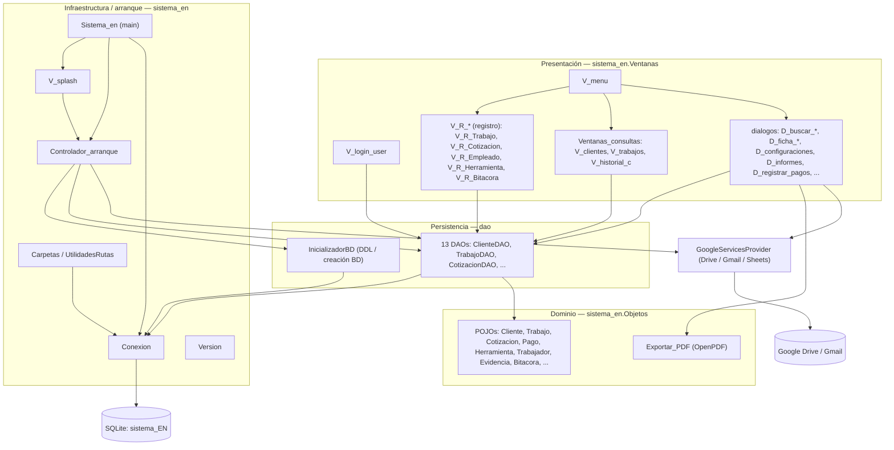

**Responsabilidades por paquete**

| Paquete | Rol |
|---|---|
| `sistema_en` | Punto de entrada, splash, arranque, conexión, rutas, versión y servicios Google. |
| `dao` | Acceso a datos JDBC/SQLite y creación del esquema. |
| `sistema_en.Objetos` | Modelo de dominio (POJOs) y exportación a PDF. |
| `sistema_en.Ventanas` | Ventanas principales (`JFrame`). |
| `sistema_en.Ventanas.dialogos` | Diálogos modales (`JDialog`). |
| `sistema_en.Ventanas.Ventanas_consultas` | Listados y consultas. |
| `sistema_en.Ventanas.No_utilizadas` | Código obsoleto (no referenciado). |

---

## 2. Flujo de arranque y login

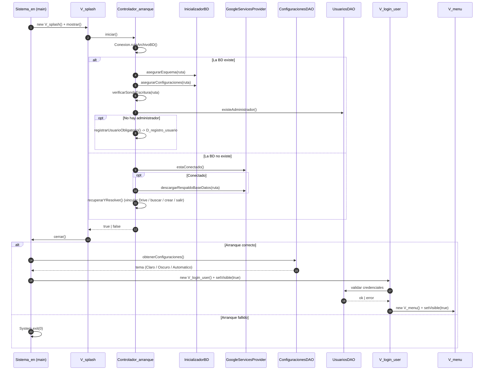

---

## 3. Modelo de datos (ER)

Esquema definido en `dao/InicializadorBD.java` (SQLite). Los nombres de atributos se
muestran normalizados sin acentos (p. ej. `contrasena` = columna `contraseña`).

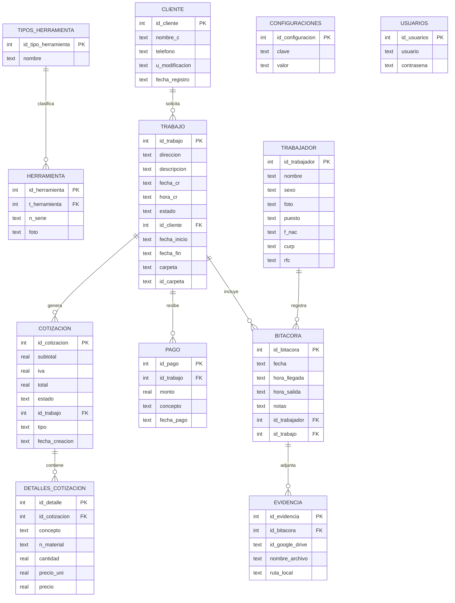

**Resumen de tablas**

| Tabla | Descripción | FK |
|---|---|---|
| `Configuraciones` | Pares clave/valor del sistema (tema, carpetas, opciones). | — |
| `Usuarios` | Cuentas de acceso (contraseña con hash `jbcrypt`). | — |
| `Tipos_herramienta` | Catálogo de tipos de herramienta. | — |
| `Herramienta` | Herramientas con serie y foto. | `t_herramienta → Tipos_herramienta` |
| `Cliente` | Clientes. | — |
| `Trabajo` | Trabajos por cliente y su carpeta de evidencias. | `id_cliente → Cliente` |
| `Trabajador` | Personal. | — |
| `Cotizacion` | Cotizaciones ligadas a un trabajo. | `id_trabajo → Trabajo` |
| `Detalles_cotizacion` | Renglones de cada cotización. | `id_cotizacion → Cotizacion` (CASCADE) |
| `Pago` | Pagos recibidos por trabajo. | `id_trabajo → Trabajo` |
| `Bitacora` | Visitas/registros de trabajadores en trabajos. | `id_trabajador`, `id_trabajo` |
| `Evidencia` | Archivos/fotos adjuntos a una bitácora (Drive). | `id_bitacora → Bitacora` |

---

## 4. Navegación de ventanas

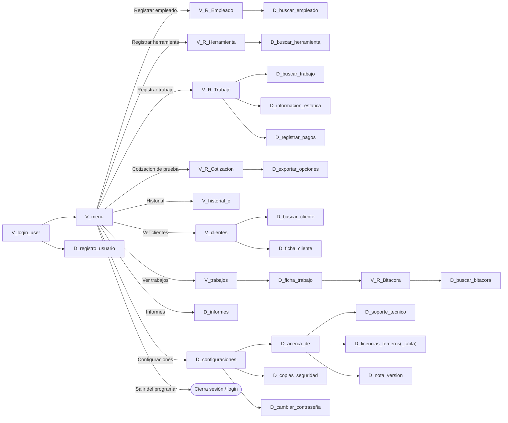

> Nota: `V_R_Bitacora` se abre desde `D_ficha_trabajo` (ficha del trabajo), no directamente desde el menú.

---

## 5. Integraciones externas y despliegue

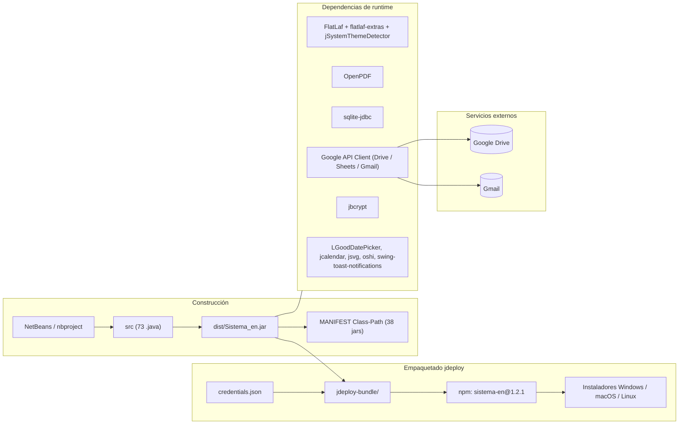

**Servicios de `GoogleServicesProvider`**

| Método | Uso |
|---|---|
| `getCredentials` / `vincularNuevaCuenta` | OAuth 2.0 y vinculación de cuenta. |
| `subirArchivo` / `descargarRespaldoBaseDatos` | Respaldo y restauración de la BD en Drive. |
| `subirImagenACarpeta` / `listarArchivosDeCarpeta` / `obtenerIdCarpetaEvidencias` / `buscarCarpeta` | Evidencias de bitácora. |
| `getGmailService` | Envío de correos (soporte). |
| `getSheetsService` | Acceso a hojas de cálculo. |

---

## 6. Clases por módulo

### 6.1 Arranque y base de datos

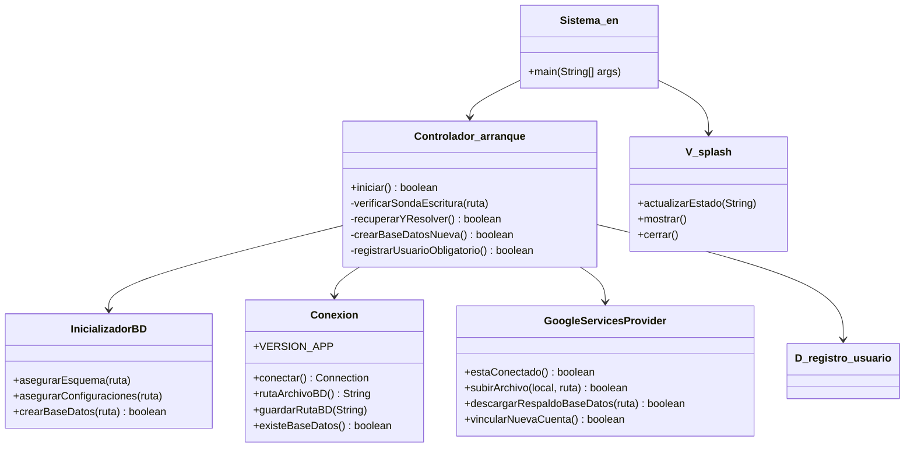

### 6.2 Autenticación y usuarios

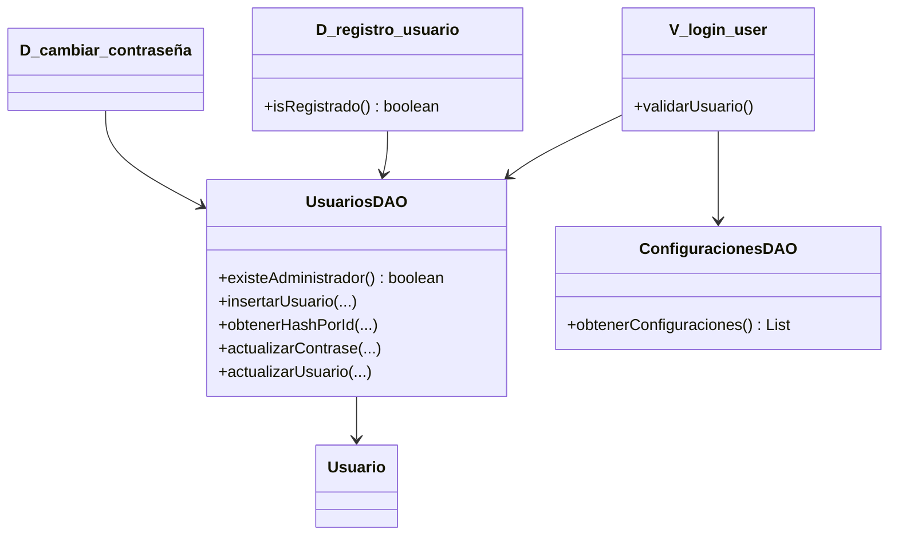

### 6.3 Clientes

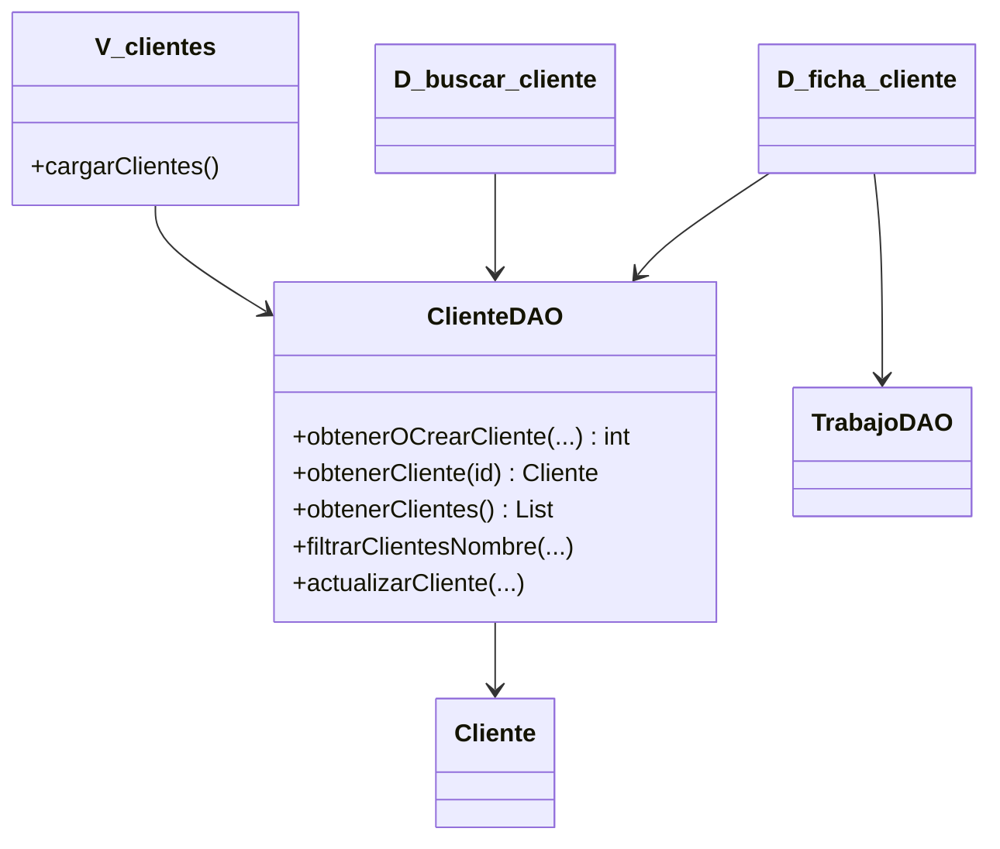

### 6.4 Trabajos y fichas

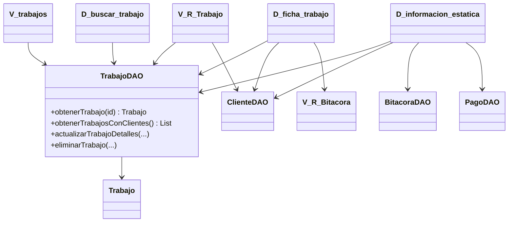

### 6.5 Cotizaciones y exportación PDF

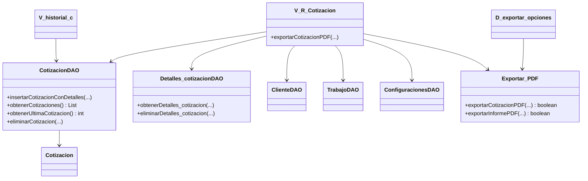

### 6.6 Pagos

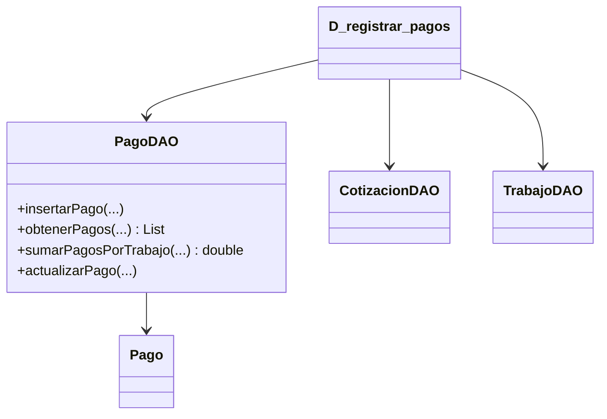

### 6.7 Herramientas y tipos

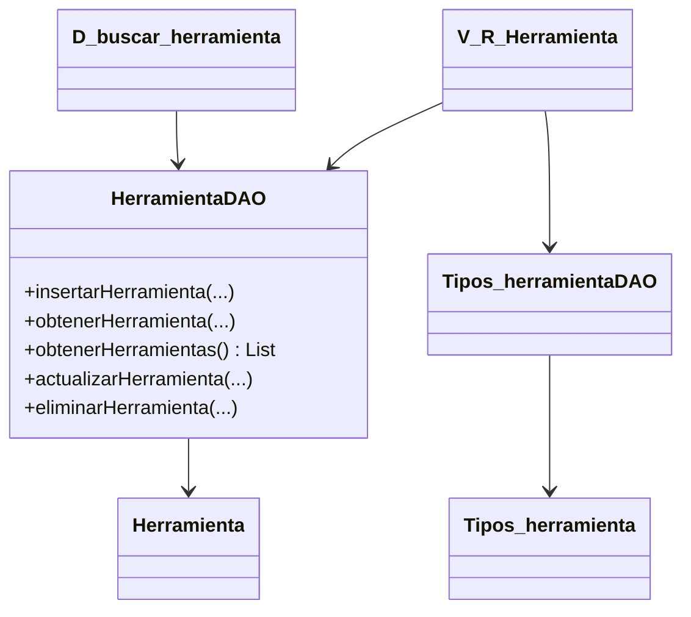

### 6.8 Personal (trabajadores)

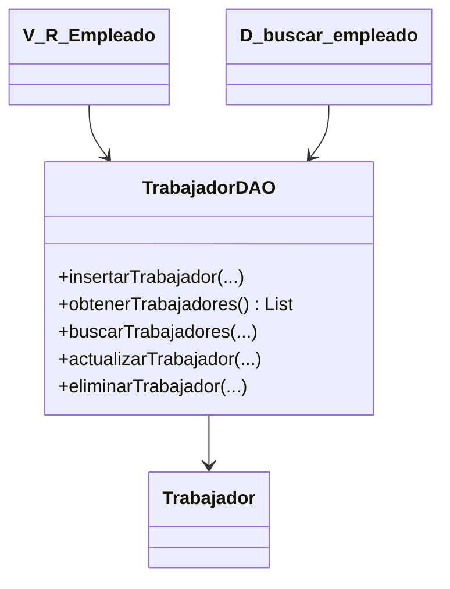

### 6.9 Bitácora y evidencias

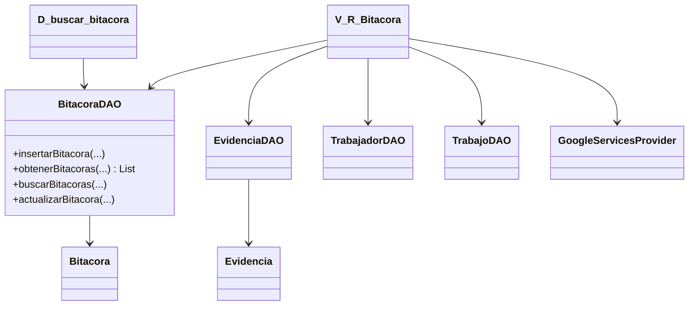

### 6.10 Informes

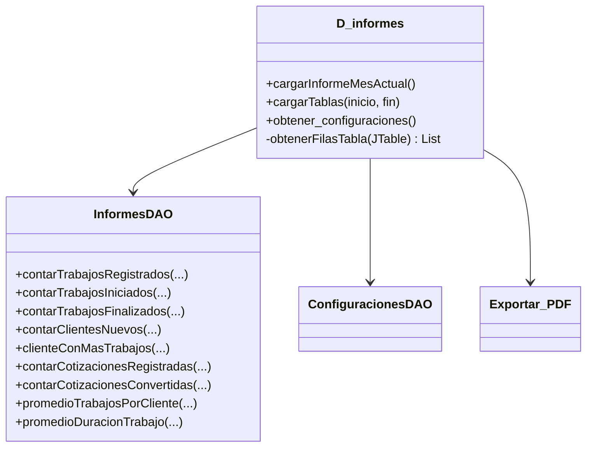

### 6.11 Sistema, configuración y respaldos

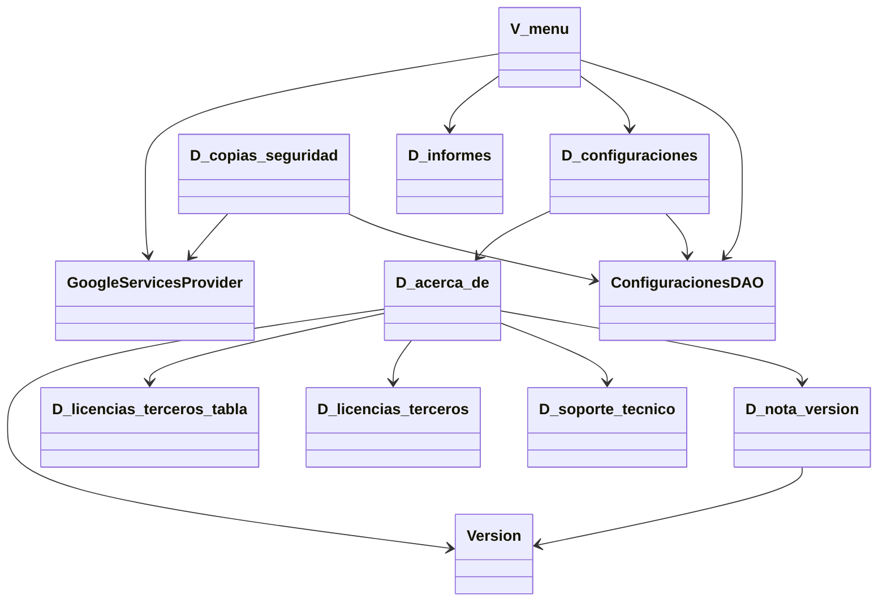

---

## 7. Notas y convenciones

- **Sin ORM:** cada `*DAO` abre conexiones con `Conexion.conectar()` y usa `PreparedStatement` + `try-with-resources`. Un DAO por entidad principal; las estadísticas se agrupan en `InformesDAO`.
- **Nombres de dominio:** las columnas de BD conservan el estilo `snake_case` y acentos originales (`contraseña`, `fecha_creación`); los POJOs exponen getters/setters equivalentes.
- **Configuración del usuario:** `base_de_datos.properties` y el token OAuth se resuelven con `UtilidadesRutas` (`directorioConfigUsuario`, `directorioTokens`).
- **Exportación:** `Exportar_PDF` usa OpenPDF para cotizaciones e informes; la salida se guarda en la carpeta configurada (`carpeta_ce/Informes/`).
- **Código obsoleto:** el paquete `sistema_en.Ventanas.No_utilizadas` (`V_ficha_trabajo`, `V_pago_recibido`) no participa en el flujo actual.
- **Empaquetado:** `jdeploy` genera instaladores nativos a partir de `dist/Sistema_en.jar`; el `MANIFEST` declara las 38 dependencias de `lib/`.

### Cómo mantener este documento

1. Actualizar la versión al publicar (coincidir con `Conexion.VERSION_APP`).
2. Si cambia el esquema, editar el DDL en `InicializadorBD` **y** el diagrama ER.
3. Si se añaden ventanas o DAOs, actualizar los diagramas 4 y 6.
4. Validar el render de Mermaid en la vista previa antes de commitear.
