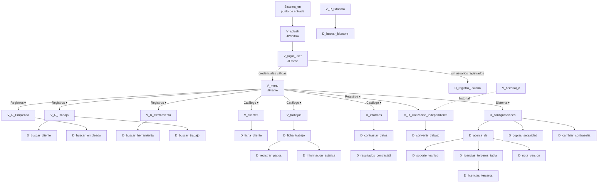

# Pantallas y formularios — Sistema EN

Inventario de las **35 pantallas** de la aplicación (Swing), con su nombre visible, utilidad,
lugar de apertura, comportamiento de ventana y una revisión de títulos desde el punto de vista
de UX.

> Documento generado por análisis estático del código. No se modificó ninguna pantalla.

---

## Índice

1. [Resumen](#1-resumen)
2. [Diagrama de navegación](#2-diagrama-de-navegación)
3. [Inventario de pantallas](#3-inventario-de-pantallas)
   - [3.1 Arranque](#31-arranque)
   - [3.2 Ventanas principales](#32-ventanas-principales)
   - [3.3 Ventanas de consulta](#33-ventanas-de-consulta)
   - [3.4 Fichas de entidad](#34-fichas-de-entidad)
   - [3.5 Buscadores](#35-buscadores)
   - [3.6 Diálogos de operación](#36-diálogos-de-operación)
   - [3.7 Sistema, usuarios y legal](#37-sistema-usuarios-y-legal)
4. [Revisión de títulos](#4-revisión-de-títulos)
5. [Hallazgos de UX](#5-hallazgos-de-ux)
6. [Anexo técnico](#6-anexo-técnico)

---

## 1. Resumen

| Tipo de ventana | Cantidad | Con título |
|---|---:|---:|
| `JWindow` (pantalla de arranque) | 1 | 0 |
| `JFrame` (ventanas principales y de consulta) | 11 | 0 |
| `JDialog` (diálogos) | 23 | 3 |
| **Total** | **35** | **3** |

Solo el **8.6 %** de las pantallas tiene título en la barra del sistema.

**Las 3 pantallas con título**

| Pantalla | Título | Nota |
|---|---|---|
| `D_registro_usuario` | `Registro inicial de usuario` | Único título fijado como propiedad del `.form` |
| `D_resultados_contraste2` | `Resultados del Contraste (p1 vs p2)` | Dinámico, cambia por periodo |
| `D_resultados_contraste` | `Resultados del Contraste` | **Código huérfano**, nunca se instancia |

**Distribución de comportamientos de cierre**

| Cierre | Pantallas | Significado |
|---|---:|---|
| `DISPOSE_ON_CLOSE` | 30 | Cierra solo esa ventana |
| `DO_NOTHING_ON_CLOSE` | 12 | Obliga a confirmar antes de cerrar (se cambia a `DISPOSE` tras confirmar) |
| `EXIT_ON_CLOSE` | 3 | Cierra la **aplicación** completa |
| Fijo sin cierre | 1 | `V_splash` |

---

## 2. Diagrama de navegación

---

## 3. Inventario de pantallas

### 3.1 Arranque

#### `V_splash` — «Sistema EN»

| | |
|---|---|
| **Tipo** | `JWindow` sin decorar (sin barra de título por diseño) |
| **Ruta** | `src/animaciones/V_splash.java` |
| **Título** | No aplica |
| **Uso** | Se muestra al arrancar mientras se prepara la base de datos. Muestra «Sistema EN», la versión y el estado «Iniciando…». |

#### `V_login_user` — «Iniciar Sesión - Sistema de Gestión EN»

| | |
|---|---|
| **Tipo** | `JFrame`, `EXIT_ON_CLOSE`, no redimensionable |
| **Ruta** | `src/sistema_en/Ventanas/V_login_user.java` |
| **Título** | ❌ Sin título |
| **Utilidad** | Autenticación de usuarios con `BCrypt.checkpw`. Recupera la foto del usuario y muestra su rol. |
| **Uso** | Punto de entrada tras la splash. Abre `D_registro_usuario` si la base no tiene usuarios, o `V_menu` al validar. |

### 3.2 Ventanas principales

#### `V_menu` — «Menú principal»

| | |
|---|---|
| **Tipo** | `JFrame`, `DO_NOTHING_ON_CLOSE` → `EXIT_ON_CLOSE` |
| **Ruta** | `src/sistema_en/Ventanas/V_menu.java` |
| **Título** | ❌ Sin título |
| **Utilidad** | Lanzador de todos los módulos. Es la ventana principal de la sesión. |
| **Uso** | Se abre al iniciar sesión. Sus menús son el único punto de navegación del sistema. |

**Estructura del menú** (leída de `V_menu.form`)

| Menú | Opción visible | Destino |
|---|---|---|
| **Registros ▾** | Registrar empleado | `V_R_Empleado` |
| | Registrar herramienta | `V_R_Herramienta` |
| | Registrar trabajo | `V_R_Trabajo` |
| | Cotizacion independiente | `V_R_Cotizacion_independiente` |
| **Catálogo ▾** | Ver clientes | `V_clientes` |
| | Ver trabajos | `V_trabajos` |
| | Informes | `D_informes` |
| **Sistema ▾** | Configuraciones | `D_configuraciones` |
| | Salir del programa | Cierre + copia de seguridad |

#### `V_R_Trabajo` — «Registrar trabajo»

| | |
|---|---|
| **Tipo** | `JFrame`, `DO_NOTHING_ON_CLOSE` → `DISPOSE_ON_CLOSE` |
| **Ruta** | `src/sistema_en/Ventanas/V_R_Trabajo.java` |
| **Título** | ❌ Sin título |
| **Utilidad** | Alta y edición de trabajos (órdenes de servicio): descripción, dirección, cliente, fechas y estado. |
| **Uso** | Menú *Registros ▾ → Registrar trabajo*. Abre `D_buscar_cliente` y `D_buscar_trabajo`. |

#### `V_R_Empleado` — «Registro de empleado»

| | |
|---|---|
| **Tipo** | `JFrame`, `DO_NOTHING_ON_CLOSE` → `DISPOSE_ON_CLOSE` |
| **Ruta** | `src/sistema_en/Ventanas/V_R_Empleado.java` |
| **Título** | ❌ Sin título |
| **Utilidad** | CRUD de trabajadores: nombre, puesto, CURP, RFC, sexo, fecha de nacimiento, salario y foto. |
| **Uso** | Menú *Registros ▾ → Registrar empleado*. Abre `D_buscar_empleado`. |

#### `V_R_Herramienta` — «Herramientas»

| | |
|---|---|
| **Tipo** | `JFrame`, `DO_NOTHING_ON_CLOSE` → `DISPOSE_ON_CLOSE` |
| **Ruta** | `src/sistema_en/Ventanas/V_R_Herramienta.java` |
| **Título** | ❌ Sin título |
| **Utilidad** | CRUD del inventario de herramientas: tipo, número de serie, estado y fotografía. |
| **Uso** | Menú *Registros ▾ → Registrar herramienta*. Abre `D_buscar_herramienta`. |

#### `V_R_Bitacora` — «Bitacora de asistencia»

| | |
|---|---|
| **Tipo** | `JFrame`, `DO_NOTHING_ON_CLOSE` → `DISPOSE_ON_CLOSE` |
| **Ruta** | `src/sistema_en/Ventanas/V_R_Bitacora.java` |
| **Título** | ❌ Sin título |
| **Utilidad** | Registro de entradas y salidas del personal, con hora, fecha y evidencias fotográficas. |
| **Uso** | Se accede desde el contexto de un trabajo. Abre `D_buscar_bitacora`. |

#### `V_R_Cotizacion` — «Cotizaciones»

| | |
|---|---|
| **Tipo** | `JFrame`, `DISPOSE_ON_CLOSE` |
| **Ruta** | `src/sistema_en/Ventanas/V_R_Cotizacion.java` |
| **Título** | ❌ Sin título |
| **Utilidad** | Editor de cotizaciones **ligadas a un trabajo**: listas de conceptos y materiales, subtotal, IVA 16 % y total. Exporta a PDF y Excel. |
| **Uso** | Se abre desde la ficha de un trabajo (`D_ficha_trabajo`). El menú ya no la ofrece: la opción quedó como «Cotización de prueba» y se sustituyó por `V_R_Cotizacion_independiente`. |

#### `V_R_Cotizacion_independiente` — «Cotización independiente»

| | |
|---|---|
| **Tipo** | `JFrame`, `DISPOSE_ON_CLOSE` |
| **Ruta** | `src/sistema_en/Ventanas/V_R_Cotizacion_independiente.java` |
| **Título** | ❌ Sin título |
| **Utilidad** | Cotizaciones para **prospectos sin cliente registrado** (nombre y teléfono libres). Incluye historial, conversión a trabajo real y exportación. |
| **Uso** | Menú *Registros ▾ → Cotizacion independiente*. Abre `D_convertir_trabajo` y `V_historial_c`. |

### 3.3 Ventanas de consulta

Las tres comparten estructura: tabla, buscador, ordenamiento y botón «Cerrar».

#### `V_clientes` — «Clientes registrados»

| | |
|---|---|
| **Tipo** | `JFrame`, `DISPOSE_ON_CLOSE` |
| **Ruta** | `src/sistema_en/Ventanas/Ventanas_consultas/V_clientes.java` |
| **Título** | ❌ Sin título |
| **Utilidad** | Catálogo de clientes con búsqueda y ordenamiento por criterios. |
| **Uso** | Menú *Catálogo ▾ → Ver clientes*. Doble clic en una fila abre `D_ficha_cliente`. |

#### `V_trabajos` — «Historial de Trabajos»

| | |
|---|---|
| **Tipo** | `JFrame`, `DISPOSE_ON_CLOSE` |
| **Ruta** | `src/sistema_en/Ventanas/Ventanas_consultas/V_trabajos.java` |
| **Título** | ❌ Sin título |
| **Utilidad** | Historial de trabajos filtrable por estado. |
| **Uso** | Menú *Catálogo ▾ → Ver trabajos*. Doble clic abre `D_ficha_trabajo`. |

#### `V_historial_c` — «Historial de cotizaciones independientes»

| | |
|---|---|
| **Tipo** | `JFrame`, **`EXIT_ON_CLOSE`**, pestañas «Cotizaciones archivadas» |
| **Ruta** | `src/sistema_en/Ventanas/Ventanas_consultas/V_historial_c.java` |
| **Título** | ❌ Sin título |
| **Utilidad** | Historial completo de cotizaciones independientes, con archivo y búsqueda por fechas. |
| **Uso** | Menú *Catálogo ▾* (historial) y desde `V_R_Cotizacion_independiente`. |

### 3.4 Fichas de entidad

#### `D_ficha_cliente` — «Ficha de cliente»

| | |
|---|---|
| **Tipo** | `JDialog`, **no modal** (constructor `(int id_cliente)`) |
| **Ruta** | `src/sistema_en/Ventanas/dialogos/D_ficha_cliente.java` |
| **Título** | ❌ Sin título |
| **Utilidad** | Datos del cliente, teléfonos y tabla de sus trabajos. Permite editar y abrir la ficha de cada trabajo. |
| **Uso** | Doble clic en `V_clientes` y desde `D_ficha_trabajo`. |

#### `D_ficha_trabajo` — «Ficha de trabajo»

| | |
|---|---|
| **Tipo** | `JDialog`, **no modal** (constructor `(int id_trabajo, int id_cliente)`), no redimensionable |
| **Ruta** | `src/sistema_en/Ventanas/dialogos/D_ficha_trabajo.java` |
| **Título** | ❌ Sin título |
| **Utilidad** | Panel central de un trabajo: estado, fecha y hora, pagos, bitácora, cotización e información estática. |
| **Uso** | Doble clic en `V_trabajos` y desde `D_ficha_cliente`. Abre `D_registrar_pagos` y `D_informacion_estatica`. |

#### `D_informacion_estatica` — «Informacion estatica»

| | |
|---|---|
| **Tipo** | `JDialog` modal, no redimensionable |
| **Ruta** | `src/sistema_en/Ventanas/dialogos/D_informacion_estatica.java` |
| **Título** | ❌ Sin título |
| **Utilidad** | Captura los datos fijos del trabajo: bitácoras asociadas y fechas de inicio y fin oficiales, calculadas o manuales. |
| **Uso** | Desde `D_ficha_trabajo`. |

### 3.5 Buscadores

Los cinco comparten plantilla y son **visualmente intercambiables**: misma distribución, misma tabla y
los mismos rótulos «Buscar», «Cancelar» y «Cerrar». El único elemento que los distingue es el
`JLabel` interno.

#### `D_buscar_cliente` — «Buscar cliente»

| | |
|---|---|
| **Tipo** | `JDialog` modal, redimensionable (mínimo 740×480) |
| **Ruta** | `src/sistema_en/Ventanas/dialogos/D_buscar_cliente.java` |
| **Título** | ❌ Sin título |
| **Utilidad** | Busca clientes por nombre y teléfono; devuelve la fila elegida. |
| **Uso** | `V_R_Trabajo` |

#### `D_buscar_empleado` — «Buscar empleado»

| | |
|---|---|
| **Tipo** | `JDialog` modal, redimensionable |
| **Ruta** | `src/sistema_en/Ventanas/dialogos/D_buscar_empleado.java` |
| **Título** | ❌ Sin título |
| **Utilidad** | Busca empleados por nombre y puesto (CURP, sexo, RFC); devuelve la fila elegida. |
| **Uso** | `V_R_Empleado` |

#### `D_buscar_herramienta` — «Buscar herramienta»

| | |
|---|---|
| **Tipo** | `JDialog` modal, tamaño fijo (740×480) |
| **Ruta** | `src/sistema_en/Ventanas/dialogos/D_buscar_herramienta.java` |
| **Título** | ❌ Sin título |
| **Utilidad** | Busca herramientas por número de serie y tipo, con fotografía, para seleccionarlas. |
| **Uso** | `V_R_Herramienta` |

#### `D_buscar_trabajo` — «Buscar trabajo»

| | |
|---|---|
| **Tipo** | `JDialog` modal, redimensionable |
| **Ruta** | `src/sistema_en/Ventanas/dialogos/D_buscar_trabajo.java` |
| **Título** | ❌ Sin título |
| **Utilidad** | Filtra trabajos por fecha de registro y estado; devuelve la fila seleccionada. |
| **Uso** | `V_R_Trabajo` |

#### `D_buscar_bitacora` — «Buscar bitacora»

| | |
|---|---|
| **Tipo** | `JDialog` modal, redimensionable |
| **Ruta** | `src/sistema_en/Ventanas/dialogos/D_buscar_bitacora.java` |
| **Título** | ❌ Sin título |
| **Utilidad** | Busca registros de bitácora (plomero, entrada/salida, evidencia) para elegir uno. |
| **Uso** | `V_R_Bitacora` |

### 3.6 Diálogos de operación

#### `D_registrar_pagos` — «Registrar pagos»

| | |
|---|---|
| **Tipo** | `JDialog` modal, redimensionable |
| **Ruta** | `src/sistema_en/Ventanas/dialogos/D_registrar_pagos.java` |
| **Título** | ❌ Sin título |
| **Utilidad** | Registra abonos de un trabajo (monto, concepto, fecha) y recalcula el saldo pendiente. |
| **Uso** | `D_ficha_trabajo`, botón «pago recibido». |

#### `D_convertir_trabajo` — «Convertir cotizacion de prueba a trabajo»

| | |
|---|---|
| **Tipo** | `JDialog` modal, redimensionable |
| **Ruta** | `src/sistema_en/Ventanas/dialogos/D_convertir_trabajo.java` |
| **Título** | ❌ Sin título |
| **Utilidad** | Convierte una cotización independiente en un trabajo real, creando el cliente si hace falta. Devuelve `getIdTrabajoCreado()`. |
| **Uso** | `V_R_Cotizacion_independiente`, botón «Convertir a trabajo». |

#### `D_contrastar_datos` — «Contrastar datos»

| | |
|---|---|
| **Tipo** | `JDialog` modal, redimensionable |
| **Ruta** | `src/sistema_en/Ventanas/dialogos/D_contrastar_datos.java` |
| **Título** | ❌ Sin título |
| **Utilidad** | Pide el periodo actual, el periodo a comparar y el tipo de contraste (numérico, textual o mixto). |
| **Uso** | `D_informes`. Lanza `D_resultados_contraste2`. |

#### `D_resultados_contraste2` — «Resultados del Contraste»

| | |
|---|---|
| **Tipo** | `JDialog` modal, redimensionable |
| **Ruta** | `src/sistema_en/Ventanas/dialogos/D_resultados_contraste2.java` |
| **Título** | ✅ `Resultados del Contraste (p1 vs p2)` — dinámico |
| **Utilidad** | Muestra la tabla de estadísticas de dos periodos con sus diferencias numéricas y el resumen textual. |
| **Uso** | `D_contrastar_datos`. **Es la versión vigente.** |

### 3.7 Sistema, usuarios y legal

#### `D_configuraciones` — «Configuraciones»

| | |
|---|---|
| **Tipo** | `JDialog` modal, `DO_NOTHING_ON_CLOSE` → `DISPOSE_ON_CLOSE` |
| **Ruta** | `src/sistema_en/Ventanas/dialogos/D_configuraciones.java` |
| **Título** | ❌ Sin título |
| **Utilidad** | Preferencias de tema, apariencia e impresión. Lanzadera a «Acerca de», «Copias de seguridad» y «Cambiar contraseña». |
| **Uso** | Menú *Sistema ▾ → Configuraciones*. |

#### `D_copias_seguridad` — «Copias de seguridad de base de datos»

| | |
|---|---|
| **Tipo** | `JDialog` modal, no redimensionable |
| **Ruta** | `src/sistema_en/Ventanas/dialogos/D_copias_seguridad.java` |
| **Título** | ❌ Sin título |
| **Utilidad** | Configura la periodicidad de los respaldos (diaria, semanal o manual) y pregunta al cerrar si faltan copias. |
| **Uso** | `D_configuraciones`. |

#### `D_cambiar_contraseña` — «Cambiar contraseña»

| | |
|---|---|
| **Tipo** | `JDialog` modal, no redimensionable |
| **Ruta** | `src/sistema_en/Ventanas/dialogos/D_cambiar_contraseña.java` |
| **Título** | ❌ Sin título |
| **Utilidad** | Valida la contraseña actual y confirma la nueva. |
| **Uso** | `D_configuraciones`. |

#### `D_registro_usuario` — «Registro inicial de usuario»

| | |
|---|---|
| **Tipo** | `JDialog` modal, redimensionable |
| **Ruta** | `src/sistema_en/Ventanas/dialogos/D_registro_usuario.java` |
| **Título** | ✅ `Registro inicial de usuario` |
| **Utilidad** | Alta del primer usuario cuando la base de datos no tiene ninguno. Expone `isRegistrado()`. |
| **Uso** | `Controlador_arranque`, al detectar la base vacía. |

#### `D_informes` — «Informe mensual»

| | |
|---|---|
| **Tipo** | `JDialog` modal, redimensionable |
| **Ruta** | `src/sistema_en/Ventanas/dialogos/D_informes.java` |
| **Título** | ❌ Sin título |
| **Utilidad** | Genera el informe mensual de un periodo, permite exportarlo y abrir el contraste contra otro periodo. |
| **Uso** | Menú *Catálogo ▾ → Informes*. |

#### `D_acerca_de` — «Acerca de» (muestra «Version 1.2.1»)

| | |
|---|---|
| **Tipo** | `JDialog` modal, redimensionable |
| **Ruta** | `src/sistema_en/Ventanas/dialogos/D_acerca_de.java` |
| **Título** | ❌ Sin título |
| **Utilidad** | Versión, créditos y descarga del manual. Lanzadera a licencias, soporte técnico y nota de versión. |
| **Uso** | `D_configuraciones`. |

#### `D_nota_version` — «Nota de version»

| | |
|---|---|
| **Tipo** | `JDialog` modal, redimensionable |
| **Ruta** | `src/sistema_en/Ventanas/dialogos/D_nota_version.java` |
| **Título** | ❌ Sin título |
| **Utilidad** | Muestra las notas de versión leídas de recursos y las solicitudes de soporte pendientes. |
| **Uso** | `D_acerca_de`. |

#### `D_soporte_tecnico` — «Soporte tecnico»

| | |
|---|---|
| **Tipo** | `JDialog` modal, redimensionable |
| **Ruta** | `src/sistema_en/Ventanas/dialogos/D_soporte_tecnico.java` |
| **Título** | ❌ Sin título |
| **Utilidad** | Captura una solicitud de soporte (tipo, prioridad, adjuntos) y la envía. |
| **Uso** | `D_acerca_de`. |

#### `D_licencias_terceros_tabla` — «Licencias de terceros»

| | |
|---|---|
| **Tipo** | `JDialog` modal, redimensionable |
| **Ruta** | `src/sistema_en/Ventanas/dialogos/D_licencias_terceros_tabla.java` |
| **Título** | ❌ Sin título |
| **Utilidad** | Índice de bibliotecas de terceros (nombre, versión, licencia) con botón «Ver licencias completas». |
| **Uso** | `D_acerca_de`. |

#### `D_licencias_terceros` — «Licencias de tercero»

| | |
|---|---|
| **Tipo** | `JDialog` modal, redimensionable |
| **Ruta** | `src/sistema_en/Ventanas/dialogos/D_licencias_terceros.java` |
| **Título** | ❌ Sin título |
| **Utilidad** | Muestra el texto completo de la licencia de una biblioteca concreta. |
| **Uso** | `D_licencias_terceros_tabla`. |

---

## 4. Revisión de títulos

### 4.1 Criterio

El título de una ventana cumple tres funciones: identificar la pantalla en la barra de tareas,
distinguirlas al alternar con Alt+Tab, y dejar claro qué se está cerrando al pulsar la ✕. Se
priorizan las pantallas donde el título aporta más y se omite donde el rótulo interno ya es
suficiente.

**Convención propuesta:** `<Módulo> — Sistema EN` para ventanas, y el nombre de la acción para
diálogos. El sufijo con el nombre de la aplicación es lo que hace útil el título en la barra de
tareas.

### 4.2 Prioridad alta

Las 11 `JFrame` comparten el mismo defecto: se abren como ventanas independientes del sistema
operativo y todas aparecen sin nombre en la barra de tareas y en Alt+Tab. Con ocho módulos abiertos
el usuario no puede saber cuál es cuál. Además, varias se invocan desde otras ventanas y pueden
 coexistir.

| Pantalla | Título propuesto |
|---|---|
| `V_menu` | `Menú principal — Sistema EN` |
| `V_login_user` | `Iniciar sesión — Sistema EN` |
| `V_R_Trabajo` | `Trabajos — Sistema EN` |
| `V_R_Empleado` | `Empleados — Sistema EN` |
| `V_R_Herramienta` | `Herramientas — Sistema EN` |
| `V_R_Bitacora` | `Bitácoras — Sistema EN` |
| `V_R_Cotizacion` | `Cotizaciones de trabajo — Sistema EN` |
| `V_R_Cotizacion_independiente` | `Cotizaciones independientes — Sistema EN` |
| `V_clientes` | `Clientes — Sistema EN` |
| `V_trabajos` | `Historial de trabajos — Sistema EN` |
| `V_historial_c` | `Historial de cotizaciones — Sistema EN` |

Los cinco **buscadores** (`D_buscar_cliente`, `D_buscar_empleado`, `D_buscar_herramienta`,
`D_buscar_trabajo`, `D_buscar_bitacora`) también son prioridad alta por otra razón: son clones
visuales entre sí. Sin título, cinco ventanas de diálogo idénticas dependen de que el usuario lea
el `JLabel` interno para saber cuál tiene abierta. Son modales, así que el título no compite con
nada.

| Pantalla | Título propuesto |
|---|---|
| `D_buscar_cliente` | `Buscar cliente` |
| `D_buscar_empleado` | `Buscar empleado` |
| `D_buscar_herramienta` | `Buscar herramienta` |
| `D_buscar_trabajo` | `Buscar trabajo` |
| `D_buscar_bitacora` | `Buscar bitácora` |

### 4.3 Prioridad media

`D_ficha_cliente` y `D_ficha_trabajo` son diálogos grandes que en la práctica se comportan como
ventanas (de hecho no son modales, ver [5.2](#52-las-fichas-no-son-modales)). Muestran información
de la entidad y se abren entre sí en cadena. Un título fija el contexto mientras el usuario
recorre cliente → trabajo → pagos.

| Pantalla | Título propuesto |
|---|---|
| `D_ficha_cliente` | `Ficha de cliente` |
| `D_ficha_trabajo` | `Ficha de trabajo` |

### 4.4 Prioridad baja

Diálogos modales, pequeños, con rótulo interno claro y botón «Cancelar». El título no aporta
información nueva, pero estandarizarlo evita que aparezcan con la barra vacía y da un patrón
homogéneo si más adelante se abre alguno en modo no modal.

| Pantalla | Título propuesto |
|---|---|
| `D_registrar_pagos` | `Registrar pagos` |
| `D_convertir_trabajo` | `Convertir cotización en trabajo` |
| `D_contrastar_datos` | `Contrastar datos` |
| `D_informacion_estatica` | `Información estática` |
| `D_configuraciones` | `Configuraciones` |
| `D_copias_seguridad` | `Copias de seguridad` |
| `D_cambiar_contraseña` | `Cambiar contraseña` |
| `D_informes` | `Informe mensual` |
| `D_acerca_de` | `Acerca de Sistema EN` |
| `D_nota_version` | `Nota de versión` |
| `D_soporte_tecnico` | `Soporte técnico` |
| `D_licencias_terceros_tabla` | `Licencias de terceros` |
| `D_licencias_terceros` | `Licencia de <biblioteca>` |

### 4.5 Sin título recomendado

| Pantalla | Motivo |
|---|---|
| `V_splash` | Es un `JWindow` sin decorar: no tiene barra de título y su texto es «Sistema EN» a pantalla completa. Un título sería invisible. |
| `D_resultados_contraste` | Código huérfano, nunca se instancia. Si se conserva, fusionar con `D_resultados_contraste2`; no merits más diseño. |

### 4.6 Cómo aplicar los títulos

Fijar el título como **propiedad `title` del `.form`** desde NetBeans Designer, no dentro del
código: las regiones `//GEN-HEADER` / `//GEN-FIRST:` se regeneran al editar el formulario y
cualquier `setTitle()` colocado dentro de ellas se pierde.

Para los títulos dinámicos (`D_resultados_contraste2`) el `setTitle()` ya está fuera de las regiones
generadas, en el constructor ([`D_resultados_contraste2.java:36`](../src/sistema_en/Ventanas/dialogos/D_resultados_contraste2.java#L36)),
y es el patrón correcto.

---

## 5. Hallazgos de UX

### 5.1 `V_historial_c` cierra la aplicación

[`V_historial_c.java:107`](../src/sistema_en/Ventanas/Ventanas_consultas/V_historial_c.java#L107)
usa `EXIT_ON_CLOSE`. Es la única ventana de consulta con ese comportamiento: `V_clientes.java:64` y
`V_trabajos.java:63` usan `DISPOSE_ON_CLOSE`. El efecto es que pulsar la ✕ de *Historial de
cotizaciones* — sin advertencia, como cualquier ventana — **termina el programa completo**.

**Recomendación:** `DISPOSE_ON_CLOSE`. Es el único criterio de la lista que parece un descuido y no
una decisión.

### 5.2 Las fichas no son modales

`D_ficha_cliente` y `D_ficha_trabajo` tienen el constructor de NetBeans `(Frame, boolean)` más un
constructor propio con la información de la entidad, y **este último no llama a
`super(padre, modal)`**. Sin esa llamada quedan no modales: el usuario puede volver a la ventana
padre con las fichas abiertas encima, lo que rompe la secuencia cliente → trabajo → pagos.

`D_ficha_trabajo` además es `setResizable(false)` (`D_ficha_trabajo.java:122`) pese a reunir pagos,
bitácora, cotización e información estática en un panel denso. **Recomendación:** pasar el padre y
`true` al constructor, y reconsiderar el tamaño fijo.

### 5.3 Componentes muertos con texto de fábrica

`V_menu.form` conserva cinco componentes no agregados a la barra de menús, con los textos que Swing
asigna por defecto:

| Componente | Texto visible |
|---|---|
| `jMenuItem1` | `jMenuItem1` |
| `jMenuItem2` | `jMenuItem2` |
| `jMenuItem3` | `jMenuItem3` |
| `jMenuItem4` | `jMenuItem4` |
| `jMenu3` | `jMenu3` |

No son visibles hoy, pero quedan a un paso de aparecer en el menú si alguien reutiliza la barra.
**Recomendación:** eliminarlos desde el Designer.

Las dos ventanas de cotización tienen el mismo tipo de resto: `jButton1` y `jCheckBox1`, con los
textos `jButton1` y `jCheckBox1`. Están dentro de `jInternalFrame1`, el contenedor huérfano que
quedó del antiguo spinner de carga, así que tampoco se ven. Conviene limpiar ambos `.form` en la
misma pasada.

### 5.4 Diálogo duplicado y huérfano

`D_resultados_contraste` **nunca se instancia**: no hay ningún `new D_resultados_contraste(...)` en
el proyecto. El diálogo vivo es `D_resultados_contraste2`, con constructor idéntico. Mantener dos
clases casi iguales garantiza que se corrija una y se olvide la otra.

**Recomendación:** eliminar `D_resultados_contraste` y su `.form`.

### 5.5 Erratas en rótulos visibles

Textos que el usuario lee en pantalla:

| Pantalla | Texto actual | Sugerencia |
|---|---|---|
| `V_menu` | «Cotizacion independiente» | «Cotización independiente» |
| `V_R_Cotizacion` | «Numero de cotizacion», «Numero de trabajo», «Fecha de creacion» | «Número de cotización», «Número de trabajo», «Fecha de creación» |
| `V_R_Cotizacion_independiente` | «Nombre del prospecto», «Telefono del prospecto» | «Nombre del prospecto», «Teléfono del prospecto» |
| `V_historial_c` | «Fecha de incio» | «Fecha de inicio» |
| `V_R_Bitacora` | «Bitacora de asistencia», «Descripcion / Notas» | «Bitácora de asistencia», «Descripción / Notas» |
| `V_clientes` | «Limpiar busqueda», «Ordenar por:» | «Limpiar búsqueda», «Ordenar por:» |
| `V_historial_c` | «Archivar cotizacion», «Cotizaciones archivadas» | «Archivar cotización», «Cotizaciones archivadas» |
| `D_convertir_trabajo` | «Convertir cotizacion de prueba a trabajo» | «Convertir cotización en trabajo». Además el rótulo quedó desfasado: la cotización ya no es «de prueba». |
| `D_informacion_estatica` | «Informacion estatica» | «Información estática» |
| `D_nota_version` | «Nota de version» | «Nota de versión» |
| `D_soporte_tecnico` | «Soporte tecnico» | «Soporte técnico» |
| `D_licencias_terceros` | «Licencias de tercero» | «Licencia de <biblioteca>» |
| `D_resultados_contraste` | — | «Contrastar datos» (con el fin de tuteo) |

El patrón es consistente: los rótulos con tilde se escribieron en los formularios de la primera
generación y los nuevos, añadidos por código o en archivos posteriores, nunca la llevan.

### 5.6 `MODULOS.md` necesita sincronizarse

Su sección 6 quedó desalineada respecto al código actual:

| Afirmación en `MODULOS.md` | Estado real |
|---|---|
| `LoadingSpinner` en `animaciones/`, en uso por `V_R_Cotizacion` | Clase eliminada; sus llamadas también |
| `V_splash` listada en `Ventanas/` | Vive en `animaciones/` |
| Menú «Cotizaciones → Cotización de prueba (`Prueba`)» | La opción es «Cotizacion independiente» y abre `V_R_Cotizacion_independiente` |
| `D_resultados_contraste` marcada ✅ | Huérfana; falta `D_resultados_contraste2` |
| `D_exportar_opciones` como diálogo huérfano | Ya no existe en el proyecto |
| `V_R_Cotizacion` con botón *Convertir a trabajo* sin listener | Ese botón está en `V_R_Cotizacion_independiente`, no en `V_R_Cotizacion` |

---

## 6. Anexo técnico

Ordenado por líneas de código. `U` = usable · `⚠` = conObservaciones (ver [sección 5](#5-hallazgos-de-ux)).

| Clase | Ruta (`src/`) | LOC | `.form` | Estado |
|---|---|---:|:---:|---|
| `V_R_Cotizacion` | `sistema_en/Ventanas/` | 2 323 | Sí | U |
| `V_R_Cotizacion_independiente` | `sistema_en/Ventanas/` | 2 163 | Sí | U |
| `V_R_Bitacora` | `sistema_en/Ventanas/` | 1 877 | Sí | U |
| `V_R_Empleado` | `sistema_en/Ventanas/` | 1 448 | Sí | U |
| `V_R_Trabajo` | `sistema_en/Ventanas/` | 1 215 | Sí | U |
| `V_R_Herramienta` | `sistema_en/Ventanas/` | 977 | Sí | U |
| `V_menu` | `sistema_en/Ventanas/` | 822 | Sí | ⚠ |
| `D_registrar_pagos` | `sistema_en/Ventanas/dialogos/` | 797 | Sí | U |
| `D_copias_seguridad` | `sistema_en/Ventanas/dialogos/` | 708 | Sí | U |
| `D_ficha_cliente` | `sistema_en/Ventanas/dialogos/` | 681 | Sí | ⚠ |
| `D_acerca_de` | `sistema_en/Ventanas/dialogos/` | 673 | Sí | U |
| `D_ficha_trabajo` | `sistema_en/Ventanas/dialogos/` | 642 | Sí | ⚠ |
| `D_configuraciones` | `sistema_en/Ventanas/dialogos/` | 646 | Sí | U |
| `D_cambiar_contraseña` | `sistema_en/Ventanas/dialogos/` | 619 | Sí | U |
| `D_informes` | `sistema_en/Ventanas/dialogos/` | 617 | Sí | U |
| `D_buscar_empleado` | `sistema_en/Ventanas/dialogos/` | 513 | Sí | U |
| `D_informacion_estatica` | `sistema_en/Ventanas/dialogos/` | 476 | Sí | U |
| `V_clientes` | `sistema_en/Ventanas/Ventanas_consultas/` | 590 | Sí | U |
| `V_historial_c` | `sistema_en/Ventanas/Ventanas_consultas/` | 575 | Sí | ⚠ |
| `V_trabajos` | `sistema_en/Ventanas/Ventanas_consultas/` | 464 | Sí | U |
| `V_login_user` | `sistema_en/Ventanas/` | 478 | Sí | U |
| `D_buscar_cliente` | `sistema_en/Ventanas/dialogos/` | 422 | Sí | U |
| `D_convertir_trabajo` | `sistema_en/Ventanas/dialogos/` | 375 | Sí | U |
| `D_soporte_tecnico` | `sistema_en/Ventanas/dialogos/` | 341 | Sí | U |
| `D_buscar_trabajo` | `sistema_en/Ventanas/dialogos/` | 317 | Sí | U |
| `D_licencias_terceros_tabla` | `sistema_en/Ventanas/dialogos/` | 312 | Sí | U |
| `D_buscar_herramienta` | `sistema_en/Ventanas/dialogos/` | 301 | Sí | U |
| `D_buscar_bitacora` | `sistema_en/Ventanas/dialogos/` | 290 | Sí | U |
| `D_resultados_contraste2` | `sistema_en/Ventanas/dialogos/` | 277 | Sí | U |
| `D_contrastar_datos` | `sistema_en/Ventanas/dialogos/` | 270 | Sí | U |
| `D_resultados_contraste` | `sistema_en/Ventanas/dialogos/` | 223 | Sí | ⚠ huérfana |
| `D_nota_version` | `sistema_en/Ventanas/dialogos/` | 193 | Sí | U |
| `D_registro_usuario` | `sistema_en/Ventanas/dialogos/` | 173 | Sí | U |
| `D_licencias_terceros` | `sistema_en/Ventanas/dialogos/` | 134 | Sí | U |
| `V_splash` | `animaciones/` | 94 | **No** | U |

**Notas del anexo**

- `V_splash` es la única pantalla sin `.form`: se construye íntegramente a mano, porque es un
  `JWindow` sin decorar.
- Los demás archivos `.java` tienen su `.form` correspondiente; no hay componentes huérfanos entre
  los formularios.
- **Total: 14 900 líneas** en las 35 pantallas.